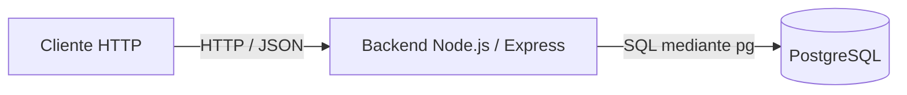
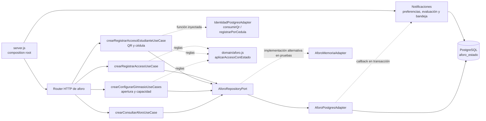
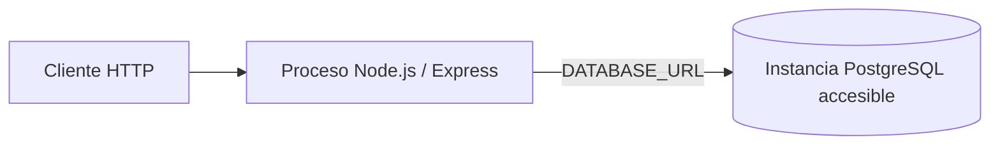
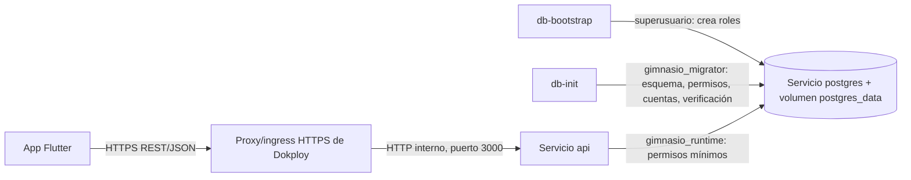
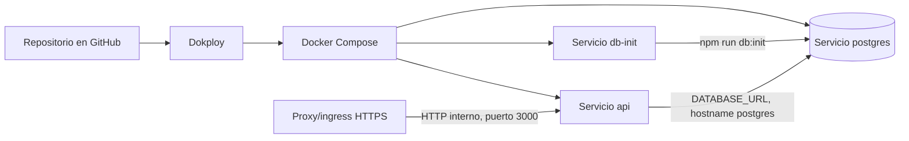

**Equipo:** Sebastián Felipe Caicedo Acosta, Pedro Luis Pallares De La Hoz, Rodrigo Andrés Facio Lince Beltrán
**Curso:** Arquitectura de Software — Universidad Tecnológica de Bolívar

> Basado en arc42 Template v9.0-EN. Este documento separa el backend comprobable del producto objetivo. “IMPLEMENTADO” se reserva para capacidades presentes en el código y respaldadas por pruebas; “OBJETIVO / FUTURO” identifica capacidades planificadas que aún no existen.

# 1. Introducción y objetivos

## 1.1 Visión general

El gimnasio de la Universidad Tecnológica de Bolívar alcanza su máxima capacidad en ciertos horarios. Los estudiantes pueden desplazarse sin saber si hay cupo; además, la disponibilidad real puede diferir del horario previsto.

El propósito del producto es ofrecer información confiable sobre la disponibilidad del gimnasio. El repositorio incluye un backend, una aplicación Flutter y un flujo de acceso individual demostrable con cuentas sintéticas.

## 1.2 Alcance implementado y objetivo

**IMPLEMENTADO:** backend Node.js/Express con Arquitectura Hexagonal / Ports and Adapters; consulta y registro de aforo; cuentas estudiantiles sintéticas; sesión temporal; QR de un solo uso; escaneo desde Flutter; transacción PostgreSQL; readiness, liveness, métricas locales, logs estructurados y cierre ordenado ante `SIGTERM`.

**IMPLEMENTADO:** la app Flutter consulta el aforo, permite iniciar sesión con una cuenta estudiantil sintética y muestra un QR temporal; el operador puede escanearlo, buscar al estudiante por cédula o registrar una transición sin identificación. El QR se consume y el aforo se actualiza en una transacción PostgreSQL. El encargado abre y cierra el gimnasio (con motivo opcional) y define la capacidad máxima; con el gimnasio cerrado se bloquean las entradas, y una entrada que supera la capacidad exige su confirmación (ADR-0012). La app muestra estado, aforo, porcentaje de ocupación y cupos, y se actualiza cada 15 segundos. Los estudiantes sincronizan preferencias individuales de alertas de aforo y ven los avisos en la pestaña existente; evaluación horaria y deduplicación persisten en PostgreSQL. **OBJETIVO / FUTURO:** SSO institucional; roles individuales; historial completo de accesos y deduplicación de operaciones manuales; WebSocket; push FCM; IaC completa y definición final de costos. La API y PostgreSQL se despliegan juntos en Dokploy con Docker Compose y login propio (ADR-0011); Render y Supabase fueron alternativas que no se mantuvieron.

La identidad usada es sintética y no representa cuentas UTB reales. La tabla de estado individual no constituye un historial de eventos.

## 1.3 Objetivos de calidad

- **Consistencia del contador:** serializar transiciones PostgreSQL concurrentes y no perder actualizaciones en el escenario probado.
- **Mantenibilidad:** aislar el dominio de Express y del driver PostgreSQL mediante el puerto de persistencia.
- **Operación verificable:** separar liveness (`/health`) de readiness (`/ready`) y consultar contadores operacionales (`/metrics`).

Rendimiento bajo carga, alta disponibilidad cloud, SSO institucional y experiencia móvil en dispositivos reales siguen sin evidencia de verificación.

## 1.4 Stakeholders

| Stakeholder | Interés y estado |
|---|---|
| Estudiantes | Quieren conocer la disponibilidad y presentar un QR. La autenticación disponible usa exclusivamente cuentas sintéticas de demostración. |
| Encargado del gimnasio | Registra accesos por QR, por cédula o sin identificación; abre y cierra el gimnasio y define la capacidad máxima (ADR-0012). |
| Bienestar Universitario y área administrativa | Interesados en la gestión del aforo y el uso del gimnasio. |
| Equipo de desarrollo y evaluadores | Necesitan decisiones trazables y evidencia verificable por corte académico. |

# 2. Restricciones de arquitectura

## 2.1 Organizacionales y académicas

La solución se desarrolla como proyecto académico incremental y su arquitectura debe poder explicarse y verificarse. El uso de IA debe registrarse conforme a las políticas del curso.

**IMPLEMENTADO Y VERIFICADO:** deployment mediante Dokploy y Docker Compose, accesible en `https://gimnasio-utb.iscoutb.dev`. Render fue considerado como alternativa y no es el deployment actual. SonarCloud analiza el repositorio mediante la integración de la organización en GitHub; el Quality Gate se consulta en su panel.

## 2.2 Técnicas implementadas

- Node.js 18 o superior, Express y `pg`.
- El servidor real crea `AforoPostgresAdapter` y requiere `DATABASE_URL`.
- `npm run db:init` ejecuta `src/modules/aforo/infrastructure/persistence/schema.sql`.
- El esquema contiene una fila de estado con `id = 1` y un contador entero no negativo.
- El adapter PostgreSQL aplica cada transición en una transacción y bloquea la fila antes de modificarla.
- `createApp()` acepta un repositorio inyectado y usa el adapter en memoria por defecto, lo que permite pruebas sin base de datos.

## 2.3 Restricciones y requisitos futuros

El repositorio contiene el proyecto Flutter/UI y la configuración de deployment Docker Compose para Dokploy. El flujo QR usa cuentas sintéticas y no integra SSO ni datos institucionales. Roles individuales de operadores, push FCM y WebSocket no están implementados. La infraestructura de Dokploy es externa al repositorio; Compose es configuración de deployment versionada, no IaC completa.

# 3. Contexto y alcance del sistema

## 3.1 Contexto de negocio

El backend expone el contador agregado y asocia accesos QR con cuentas sintéticas. La escritura manual sigue usando un token compartido de operador; no hay autenticación individual de encargados.

## 3.2 Contexto técnico implementado



El cliente HTTP invoca la API. El servidor real persiste el contador en PostgreSQL mediante `AforoPostgresAdapter`. En pruebas, `createApp()` puede componer `AforoMemoriaAdapter`.

El cliente Flutter consume las rutas de aforo, estudiantes y notificaciones descritas en `docs/openapi.yaml`. El operador envía `Authorization: Bearer` con el token compartido (ADR-0007); la sesión de estudiante es separada y solo aplica a cuentas sintéticas. La bandeja de notificaciones in-app está implementada; FCM y WebSocket siguen siendo futuros.

## 3.3 Interfaces HTTP implementadas

- `GET /health`: liveness estático.
- `GET /ready`: consulta el repositorio; responde `503` si la lectura falla.
- `GET /metrics`: devuelve `access_operations_total` en memoria, separado en `entrada`, `salida` y `total`.
- `GET /api/v1/aforo`: consulta el contador actual.
- `POST /api/v1/aforo/acceso`: acepta `tipoAcceso` con valor `ENTRADA` o `SALIDA`. Exige `Authorization: Bearer <token de operador>` (`401` sin token válido; `503` si el servidor no tiene `OPERADOR_TOKEN`; `413` si el cuerpo supera 1 KB). ADR-0007.

Los contratos y cuerpos de respuesta están descritos en `docs/openapi.yaml`; las rutas de aforo se implementan en `src/modules/aforo/infrastructure/http/aforo.router.js`.

# 4. Estrategia de solución

## 4.1 Arquitectura implementada

El backend es un monolito organizado con Arquitectura Hexagonal / Ports and Adapters:

- **Dominio:** `src/modules/aforo/domain/aforo.js` valida y calcula la transición del contador y aplica las reglas del estado del gimnasio (cerrado bloquea entradas; superar la capacidad exige confirmación), sin depender de Express ni PostgreSQL.
- **Aplicación:** `registrar-acceso.usecase.js` (registro sin identificación), `registrar-acceso-estudiante.usecase.js` (QR y cédula, en la transacción del aforo), `configurar-gimnasio.usecase.js` (apertura y capacidad) y `consultar-aforo.usecase.js` (estado y porcentaje de ocupación).
- **Puerto:** `AforoRepositoryPort` define `obtenerAforoActual()`, `obtenerEstado()`, `actualizarAforo(transicionar)` y `modificarEstado(transformar)`.
- **Infraestructura:** Express implementa el adapter HTTP; `AforoPostgresAdapter` y `AforoMemoriaAdapter` implementan el contrato de persistencia.
- **Composición:** `src/server.js` usa PostgreSQL al ejecutar el servidor real y permite inyectar otro repositorio en `createApp()`.

## 4.2 Persistencia y observabilidad

PostgreSQL conserva el contador actual. El adapter ejecuta la transición en una transacción y usa `SELECT ... FOR UPDATE` para serializar modificaciones sobre la fila. Ante errores intenta `ROLLBACK`; si la operación termina correctamente confirma con `COMMIT`.

La observabilidad implementada es básica: logs JSON en stdout, `/health`, `/ready` y `/metrics`. La métrica es local al proceso; no se integra con Prometheus ni con un agregador externo.

## 4.3 Arquitectura objetivo

**OBJETIVO / FUTURO:** añadir SSO, roles individuales de operador, historial completo, WebSocket y push FCM. El deployment runtime actual se describe en la sección 7.

# 5. Vista de bloques

## 5.1 Composición y flujo de dependencias



El composition root inyecta el repositorio y la función de identidad que resuelve al estudiante; el módulo de aforo no importa el de identidad. El adapter de memoria es una implementación alternativa del puerto y se usa por defecto en las pruebas de `createApp()` que no requieren PostgreSQL.

## 5.2 Bloques existentes y responsabilidades

| Bloque | Responsabilidad | Evidencia |
|---|---|---|
| Composition root | Construye Express, selecciona/injecta repositorio, registra health, readiness y métricas. | `src/server.js` |
| Adapter HTTP | `GET /`, `POST /acceso`, `/acceso-qr` y `/acceso-cedula`, `PUT /estado` y `/capacidad`; traduce los errores de dominio a `400` y `409` (con `code`). | `src/modules/aforo/infrastructure/http/aforo.router.js`, `src/server.js` |
| Casos de uso de registro | Sin identificación, o de un estudiante identificado por QR o cédula, siempre dentro de una actualización atómica del aforo. | `src/modules/aforo/application/registrar-acceso.usecase.js`, `registrar-acceso-estudiante.usecase.js`, `registrar-acceso-qr.usecase.js` |
| Casos de uso del encargado | Abrir o cerrar con motivo y cambiar la capacidad. | `src/modules/aforo/application/configurar-gimnasio.usecase.js` |
| Caso de uso de consulta | Estado del gimnasio con porcentaje de ocupación. | `src/modules/aforo/application/consultar-aforo.usecase.js` |
| Dominio | Acepta `ENTRADA`/`SALIDA`, rechaza salidas desde cero, entradas con el gimnasio cerrado y entradas sin confirmar que superan la capacidad; valida motivo y capacidad. | `src/modules/aforo/domain/aforo.js` |
| Puerto | Contrato de lectura, transición atómica del aforo y cambio atómico del estado. | `src/modules/aforo/application/ports/aforo-repository.port.js` |
| Adapter PostgreSQL | Ejecuta transacción, bloqueo de fila, actualización y rollback. | `src/modules/aforo/infrastructure/persistence/aforo-postgres.adapter.js` |
| Adapter en memoria | Implementación en RAM del mismo puerto. | `src/modules/aforo/infrastructure/persistence/aforo-memoria.adapter.js` |
| Identidad | Login propio, sesiones, QR, búsqueda y registro por cédula y estado individual dentro/fuera. | `src/modules/identidad/` |
| Notificaciones | Sincroniza preferencias, evalúa episodios bajo umbral con zona `America/Bogota` y expone la bandeja del estudiante. FCM no está configurado. | `src/modules/notificaciones/` |
| Esquema | Fila única `aforo_estado` (aforo, capacidad, apertura y motivo, con `CHECK`), cuentas sintéticas, sesiones, QR, estado individual, preferencias y notificaciones. | `src/modules/aforo/infrastructure/persistence/schema.sql`, `db/migrations/` |

No existen usuarios por encargado, historial de accesos, WebSocket ni Firebase Cloud Messaging.

# 6. Vista de ejecución

## 6.1 Registrar una entrada o salida

**Flujo exitoso implementado:**

```text
POST /api/v1/aforo/acceso
  -> router HTTP
  -> crearRegistrarAccesoUseCase
  -> AforoRepositoryPort.actualizarAforo(transicionar)
  -> AforoPostgresAdapter
  -> BEGIN
  -> SELECT aforo_actual, capacidad_maxima, abierto, motivo_cierre ... FOR UPDATE
  -> ejecutar transición de dominio aplicarAccesoConEstado(...)
  -> UPDATE aforo_estado
  -> COMMIT
  -> HTTP 201 { status: "success", data: { aforoActual } }
```

Con el gimnasio cerrado, una entrada responde `409 GIMNASIO_CERRADO` y las salidas siguen permitidas. Si la entrada supera la capacidad, responde `409 CAPACIDAD_SUPERADA` con el aforo y la capacidad; la app pregunta al encargado y, si confirma, repite la misma solicitud con `confirmarExcesoCapacidad: true`. Como la regla se evalúa con la fila bloqueada, dos encargados no pueden pasar la capacidad sin confirmar. El registro por QR o por cédula sigue el mismo flujo: la función de identidad se ejecuta dentro de la transacción, de modo que un rechazo revierte también el consumo del QR (ADR-0012).

Si la transición o una sentencia PostgreSQL falla después de iniciar la transacción, el adapter intenta `ROLLBACK` y vuelve a propagar el error. Para `POST /acceso`, los errores de dominio responden `400` (o `409` en los dos casos anteriores); los fallos clasificados del repositorio responden `503` con un mensaje genérico; y los errores inesperados responden `500` con un mensaje genérico. El JSON malformado se normaliza a `400` JSON en la composición Express. Los logs de entrada/dominio usan `warn`; los de infraestructura o errores inesperados usan `error` sin exponer el mensaje interno en la respuesta.

La prueba de integración PostgreSQL comprueba rechazo de salida desde cero y rollback cuando PostgreSQL rechaza una actualización mediante un trigger.

## 6.2 Consultar el contador

`GET /api/v1/aforo` pasa por `crearConsultarAforoUseCase`, que consulta el repositorio; si la lectura termina correctamente, la ruta responde `200` con `{ status: "success", data: { aforoActual, capacidadMaxima, abierto, motivoCierre, porcentajeOcupacion } }`. La lectura no ejecuta una transición. La app la repite cada 15 segundos y después de cada registro o cambio del encargado.

## 6.3 Flujos fuera del alcance

El QR de cuenta sintética sí está implementado. La apertura/cierre y la capacidad están implementadas (ADR-0012). El historial completo de accesos, la corrección con trazabilidad, difusión WebSocket y push FCM no forman parte de estos flujos.

## 6.4 Alertas automáticas de aforo

Las preferencias de cada estudiante se guardan en `preferencias_alerta_aforo`; el umbral se valida contra la capacidad bajo bloqueo de la fila de `aforo_estado`. Cada transición de aforo y cada cambio de capacidad evalúan las preferencias dentro de la misma transacción, actualizando el episodio y, si corresponde, insertando la notificación de forma idempotente. El proceso también reevalúa cada 30 segundos, de modo que una condición detectada fuera de horario se comprueba de nuevo en el siguiente período permitido. Se usa la zona `America/Bogota`; el inicio es inclusivo y el fin exclusivo. Si la capacidad disminuye bajo un umbral guardado, se conserva la preferencia y la alerta queda pausada. La bandeja se consulta en la app; el envío push requiere configuración Firebase pendiente.

# 7. Vista de despliegue

## 7.1 Topología local



El proceso real inicia `AforoPostgresAdapter` y necesita `DATABASE_URL`. Antes de usarlo, `npm run db:init` crea e inicializa la tabla. `npm start` ejecuta el servidor. El puerto predeterminado está definido en `src/server.js`.

`createApp({ aforoRepository })` permite inyectar un repositorio; sin argumento utiliza `AforoMemoriaAdapter`, como en las pruebas que no requieren base de datos. Esto no cambia el adapter elegido por el servidor real.

`/health` es liveness estático. `/ready` prueba una lectura del repositorio y responde `503` si falla. `/metrics` expone contadores locales del proceso. En `SIGTERM`, el servidor deja de aceptar conexiones, espera el cierre HTTP y luego cierra el pool PostgreSQL.

Esta vista describe ejecución local; no representa el deployment público.

## 7.2 Deployment final: Dokploy + PostgreSQL en el Compose (ADR-0011)

La API se despliega en Dokploy con `deploy/compose.lab.yaml`, que define cuatro servicios: `postgres`, `db-bootstrap`, `db-init` y `api`. PostgreSQL usa el mismo volumen `postgres_data` de S8. No hay servicios externos: el login de estudiantes también es propio.



En cada deploy:

1. `postgres` arranca y su healthcheck (`pg_isready`) pasa.
2. `db-bootstrap` usa el superusuario solo para crear o actualizar `gimnasio_migrator` y `gimnasio_runtime` (sin privilegios administrativos) y transferir al migrador las tablas de versiones anteriores.
3. `db-init`, con el rol migrador, aplica esquema y migraciones, los permisos de `runtime-grants.sql` y las cuentas de `DEMO_STUDENTS`; termina con `db:check-security` usando el rol runtime. Si algo falla, la API no arranca.
4. `api` arranca con la URL del rol runtime; su healthcheck consulta `/ready`.

La API nunca recibe la URL del superusuario ni la del migrador (`src/shared/environment.js` las elimina y `tests/postgres-connection-boundaries.test.js` lo comprueba). La conexión entre contenedores no sale de la red interna del Compose, por eso usa `DATABASE_SSL=false`. Detalle de roles y permisos en [la guía de base de datos](../base-de-datos.md). **Estado:** implementado y probado contra PostgreSQL 16 (base nueva, volumen de S8 y volumen con la versión de QR anterior); la verificación pública (`/`, `/ready`, login y flujo QR con dos celulares) se registra al desplegar.

## 7.3 Deployment de S8 (histórico)

> Esta sección describe el deployment verificado en S8. En noviembre de 2026 PostgreSQL salió temporalmente del Compose (ADR-0010) y volvió con ADR-0011, ahora con roles separados y `db-bootstrap`.

El backend está desplegado mediante la aplicación Dokploy `gimnasioutb-sistema-kresdf` en `https://gimnasio-utb.iscoutb.dev`. El flujo operativo es GitHub → Dokploy → Docker Compose → servicios `api`, `postgres` y `db-init`.



PostgreSQL es un contenedor del Compose, no una base gestionada. El servicio tiene un volumen Docker nombrado. `db-init` espera a que PostgreSQL esté saludable y aplica el esquema antes de que `api` arranque; la API espera a que `db-init` termine correctamente y su healthcheck consulta `/ready`. HTTPS termina en el proxy/ingress de Dokploy; Express escucha HTTP internamente en el puerto 3000. El volumen configura persistencia del servicio, pero no se ha documentado una prueba de retención de datos tras redeploy.

El equipo reportó PostgreSQL `Healthy`, finalización de `db-init`, arranque de `api`, `Docker Compose Deployed: ✅` y verificaciones públicas de `/health`, `/ready`, `/metrics`, consulta y registro de acceso. Esto acredita una ejecución verificada, no SLA, alta disponibilidad ni pruebas de carga.

# 8. Conceptos transversales

## 8.1 Separación hexagonal

**IMPLEMENTADO:** dominio, aplicación, puerto e infraestructura están separados. El caso de uso depende del contrato del repositorio, no de `pg`; el adapter PostgreSQL es infraestructura. El adapter de memoria permite pruebas sin DB.

## 8.2 Persistencia y estrategia de consistencia

**IMPLEMENTADO:** el contador persistido está en `aforo_estado`. El registro QR consume el token, alterna el estado individual y actualiza el contador bajo la misma transacción PostgreSQL. La operación manual conserva la actualización del contador sin asociar una identidad.

**Estrategia (S12):** la consistencia fuerte se reserva para las escrituras que protegen el invariante `aforo ≥ 0` y para lo que debe confirmarse junto con ellas; las lecturas que solo muestran el aforo bajan en el espectro. La tabla completa operación → garantía está en la [evidencia S12 §3](../s12-datos-eventos.md).

| Punto del espectro | Operaciones | Mecanismo | Estado |
|---|---|---|---|
| Fuerte (serializable sobre la fila) | Registrar entrada/salida; abrir/cerrar y capacidad; clave de idempotencia; anexar evento al log; corrección manual | Transacción local con `SELECT ... FOR UPDATE` | IMPLEMENTADO para el registro, la apertura/cierre y la capacidad (ADR-0012); el resto DISEÑO / FUTURO |
| De sesión (leer lo propio) | Respuesta al que registra | El `201` devuelve el valor del `COMMIT`; *write-through* en la caché | IMPLEMENTADO (respuesta); caché DISEÑO |
| Eventual con atraso ≤ 2 s, sin retroceso | `GET /api/v1/aforo` desde la app | Caché en proceso con TTL y versión (8.6) | DISEÑO |
| Eventual, al menos una vez, en orden | Notificaciones, WebSocket | Lectores del log con checkpoint (8.7) | FUTURO / DISEÑO |
| Eventual, T + 1 día | Reportes para Bienestar | Lote nocturno idempotente sobre el log | FUTURO / DISEÑO |
| Ninguna | `/metrics` | Contador en memoria por proceso | IMPLEMENTADO (riesgo aceptado) |

Cuando PostgreSQL no responde, las escrituras fallan con `503`: se prefiere no registrar a registrar mal. Todas las operaciones fuertes viven en la misma base, por lo que bastan transacciones locales; no se usan sagas ni transacciones distribuidas.

## 8.3 Salud y ciclo de vida

- **IMPLEMENTADO — `/health`:** liveness estático, no comprueba PostgreSQL.
- **IMPLEMENTADO — `/ready`:** consulta el repositorio; falla con `503` si no puede leer.
- **IMPLEMENTADO — `SIGTERM`:** drena el servidor HTTP y después cierra el pool PostgreSQL.

## 8.4 Logs y métricas

**IMPLEMENTADO:** `src/shared/logger.js` emite registros JSON con `timestamp`, `level`, `event` y `message`. Los callsites registran eventos de acceso, arranque y apagado con mensajes que no incluyen credenciales, `DATABASE_URL`, tokens ni payloads.

`GET /metrics` devuelve `access_operations_total` con `entrada`, `salida` y `total`. Cuenta operaciones completadas correctamente; el estado está en memoria, es por instancia/proceso y se reinicia con el proceso. No es Prometheus ni demuestra por sí misma consistencia concurrente. La evidencia de concurrencia es la prueba PostgreSQL descrita en la sección 10.

## 8.5 Conceptos futuros

**OBJETIVO / FUTURO:** SSO, roles individuales de operadores, historial completo, deduplicación de operaciones manuales, WebSocket y push FCM.

## 8.6 Caché

**DISEÑO, no implementado.** Hoy cada `GET /api/v1/aforo` consulta PostgreSQL. Detalle completo en la [evidencia S12 §4](../s12-datos-eventos.md).

- **Qué se cachea:** solo el estado público del gimnasio (aforo, capacidad y apertura). **No** se cachean la lectura dentro de una escritura, `/ready`, las respuestas del `POST`, ni identidad/QR/roles.
- **Dónde:** en el proceso de la API, como decorador de `AforoRepositoryPort` (`AforoRepositoryCacheado`). Se descartaron la caché HTTP (el servidor no puede invalidarla y los atrasos se suman) y Redis (con una sola instancia no mejora la garantía y agrega un modo de fallo).
- **Política de invalidación:**
  - Escritura confirmada en la instancia → **reemplaza** la entrada con el valor y la `version` del `COMMIT` (*write-through*).
  - Lectura o escritura que vuelve con `version` menor a la guardada → **se descarta** (nunca retroceder).
  - Error de repositorio en una escritura (resultado incierto, F5) → **se borra** la entrada.
  - Rechazo del dominio → no se toca.
  - Escrituras fuera de la instancia → las acota el **TTL de 2 s**.
  - Al vencer el TTL, una sola lectura va a la base (*single-flight*).
  - Con PostgreSQL caído no se sirven valores vencidos.
- **Requisitos:** el puerto devuelve `{ aforoActual, version }`; `/ready` usa el repositorio real; `/metrics` agrega `cache_hits` y `cache_misses`.

## 8.7 Eventos y datos derivados

**DISEÑO / FUTURO.** Decisión en [ADR-0006](../adr/0006-log-de-eventos-de-acceso.md); flujo y garantías en la [evidencia S12 §5](../s12-datos-eventos.md).

- Cada transición confirmada anexa un evento inmutable a `acceso_evento` **en la misma transacción**, numerado con `aforo_estado.version`. El log es historial, registro de idempotencia y fuente de eventos.
- Un worker (misma imagen, otro proceso) lee el log por consumidor con `consumidor_checkpoint`. Entrega **al menos una vez**; orden **total y sin huecos**, porque la versión se asigna con el bloqueo de ADR-0004 tomado.
- No hay broker: el log en PostgreSQL cumple ese papel mientras no haya consumidores externos al monolito.
- No hay motor de búsqueda: ningún escenario lo pide; las consultas de historial usarán índices de PostgreSQL.

## 8.8 Seguridad (S13)

Modelo de amenazas completo, análisis de dependencias y privacidad en la [evidencia S13](../s13-seguridad-amenazas.md). Decisión estructural en [ADR-0007](../adr/0007-autenticacion-operador-y-cors.md).

**Principios aplicados**

- **Falla cerrado:** si falta la configuración de seguridad, la operación se niega (`503`) en vez de quedar abierta.
- **La seguridad HTTP vive en el borde:** los middlewares están en `src/shared/http/seguridad.js` y los compone `server.js`. Dominio, casos de uso y adaptadores de persistencia no saben que existe un token (ADR-0001, regla M2 de `arch:check`).
- **Mínimo dato:** el backend no recolecta datos personales; los campos extra del cuerpo se ignoran y no se registran.
- **Automatizar la cadena de suministro:** lo que entra por npm, pub, Docker o Actions pasa por CI y Dependabot.

| Control | Dónde | Amenaza | Estado |
|---|---|---|---|
| Token de operador (`Bearer`) en `POST /acceso`, comparación en tiempo constante, falla cerrado | `seguridad.js`, `server.js` | T1, T5 | IMPLEMENTADO |
| CORS con lista blanca (`CORS_ORIGINS`) | `seguridad.js` | T2 | IMPLEMENTADO |
| Límite de cuerpo JSON 1 KB (`413`); autenticación antes del parseo | `server.js` | T5 | IMPLEMENTADO |
| Cabeceras defensivas; sin `X-Powered-By`; errores genéricos | `seguridad.js`, router | T6 | IMPLEMENTADO |
| Token solo en memoria en la app; nunca en logs | Flutter, logger | T3, T7 | IMPLEMENTADO |
| PostgreSQL sin puerto publicado | `compose.lab.yaml` | T12 | IMPLEMENTADO |
| `npm ci --ignore-scripts`, `npm audit`, `npm audit signatures`, permisos `contents: read`, Dependabot | CI, `.github/dependabot.yml` | T8, T10 | IMPLEMENTADO |
| Timeouts del pool; límite de tasa y HSTS en el proxy | Adapter PostgreSQL, Dokploy | T5, T13 | PENDIENTE |
| Imágenes y acciones fijadas por digest/SHA | `Dockerfile`, Compose, CI | T9, T10 | PENDIENTE |

**Configuración requerida en cada entorno:** `OPERADOR_TOKEN` (≥ 32 caracteres, generado con `crypto.randomBytes`) y `CORS_ORIGINS` (solo si se usa Flutter web). Ambas se definen en el panel de Dokploy; nunca en el repositorio.

# 9. Decisiones arquitectónicas

| Decisión | Estado y evidencia | ADR / formalización |
|---|---|---|
| Arquitectura Hexagonal / Ports and Adapters en un backend monolítico. | **IMPLEMENTADO:** dominio puro, caso de uso, puerto y adapters. | [ADR-0001](../adr/0001-arquitectura-hexagonal.md). |
| Comandos y consultas HTTP síncronos; persistencia completada antes de responder. | **IMPLEMENTADO** para las rutas actuales de aforo. | [ADR-0003](../adr/0003-comunicacion-sincrona-asincrona.md) respalda el enfoque síncrono. Su decisión FCM permanece futura. |
| PostgreSQL como persistencia del contador con transacción y bloqueo de fila. | **IMPLEMENTADO:** `AforoPostgresAdapter`, `schema.sql` y pruebas de persistencia, rollback y concurrencia. | [ADR-0004](../adr/0004-concurrencia-postgresql.md) documenta el bloqueo pesimista con `SELECT ... FOR UPDATE`, la transacción y la evidencia del escenario probado. |
| Deployment en Dokploy con PostgreSQL en el Compose, roles separados creados automáticamente y login propio. | **IMPLEMENTADO:** `deploy/compose.lab.yaml` (`postgres`, `db-bootstrap`, `db-init`, `api`), `AutenticacionLocalAdapter`, `db:check-security` en cada deploy. | [ADR-0011](../adr/0011-volver-a-postgresql-propio-y-login-local.md), que reemplaza a [ADR-0009](../adr/0009-supabase-auth.md) y [ADR-0010](../adr/0010-postgresql-gestionado-en-supabase.md). |
| Identidad sintética, sesión temporal y QR de un solo uso consumido en la transacción del aforo. | **IMPLEMENTADO:** módulo `identidad`, `qr_credenciales`, `estudiante_estado_acceso`. | [ADR-0008](../adr/0008-identidad-de-prueba-y-qr-de-acceso.md). |
| Estado del gimnasio (apertura con motivo y capacidad máxima), confirmación al superar la capacidad y registro por cédula. | **IMPLEMENTADO:** reglas en `aforo.js`, migración `20261122_002`, `PUT /api/v1/aforo/estado` y `/capacidad`, `POST /acceso-cedula`; pruebas de dominio, HTTP, contrato y PostgreSQL. | [ADR-0012](../adr/0012-estado-capacidad-y-registro-por-cedula.md). |
| Métricas en memoria, logs JSON y cierre ante SIGTERM. | **IMPLEMENTADO** en la composición del servidor y `src/shared/logger.js`. | No hay ADR independiente para estas decisiones operativas básicas. |
| No extraer Notificaciones a un servicio. | **DECIDIDO E IMPLEMENTADO COMO MÓDULO DEL MONOLITO:** preferencias, evaluación transaccional, scheduler y bandeja in-app. El envío FCM no está implementado. | [ADR-0005](../adr/0005-no-extraer-notificaciones.md). |
| Proteger el registro de accesos con token de operador y limitar CORS a una lista blanca. | **IMPLEMENTADO:** `src/shared/http/seguridad.js`, `server.js`, cliente Flutter; pruebas en `tests/seguridad.test.js` y contrato. Excepción documentada a la regla de versionado (`2.0.0` en `/api/v1`). | [ADR-0007](../adr/0007-autenticacion-operador-y-cors.md). Amenazas en la [evidencia S13](../s13-seguridad-amenazas.md). |
| Registrar cada transición en un log de eventos append-only junto al contador. | **DECIDIDO, NO IMPLEMENTADO:** hoy solo existe `aforo_estado`. Se compararon "solo estado", "estado + log", "event sourcing puro" y "broker como fuente". Refina las tablas de idempotencia y outbox de S11. | [ADR-0006](../adr/0006-log-de-eventos-de-acceso.md). Estrategia de datos en la [evidencia S12](../s12-datos-eventos.md). |

# 10. Requisitos de calidad

## 10.1 Atributos y alcance de evidencia

| Atributo | Objetivo o evidencia actual |
|---|---|
| Consistencia del contador | Hay evidencia de transacciones y concurrencia en la prueba de PostgreSQL de la sección 10.2. No prueba identidad ni deduplicación. |
| Mantenibilidad | La separación hexagonal está reflejada en el código y las pruebas unitarias del dominio. |
| Operabilidad | `/health`, `/ready`, logs, `/metrics` y el cierre por `SIGTERM` existen. Las pruebas de health/readiness verifican respuestas, no un SLA de disponibilidad. |
| Rendimiento, escalabilidad, seguridad de identidad y alta disponibilidad | **OBJETIVO / FUTURO o no medido.** Existe un deployment Dokploy verificado, pero no hay benchmark HTTP, SLA, prueba de carga, prueba WebSocket ni autenticación que respalden umbrales cuantitativos. |

## 10.2 S1 — Concurrencia sobre el contador de aforo

| Campo | Descripción |
|---|---|
| Escenario | Veinte operaciones concurrentes de entrada sobre el contador de aforo. |
| Artefacto | `AforoPostgresAdapter.actualizarAforo()` y la fila `aforo_estado`. |
| Evidencia | `tests/postgres/aforo-postgres.integration.test.js` ejecuta veinte llamadas concurrentes al adapter PostgreSQL. También comprueba persistencia entre instancias del adapter, rechazo de salida cuando el contador es cero y rollback ante un error producido por PostgreSQL. |
| Resultado | Las veinte operaciones se completan y el aforo final es 20. En la prueba implementada de 20 operaciones concurrentes contra el adapter PostgreSQL no se observaron lost updates y el estado final coincidió con las operaciones exitosas. |
| Límite | Es una prueba de integración del adapter, no una prueba de carga HTTP. No demuestra unicidad, identidad, QR ni deduplicación por estudiante, ni garantiza resultados ante cualquier carga. |

La evidencia fechada de [S9](../s9-cadena-verificada.md) reporta una ejecución el 3 de octubre de 2026, con Node v22.22.2 y PostgreSQL 16 local: base 12/12, contrato 11/11 y PostgreSQL 8/8 mediante `DATABASE_URL=... npm run test:postgres`; la suite incluye el subtest de 20 entradas concurrentes. Este es un resultado documentado, no se conserva su salida original. [La evidencia de la entrega del taller](../../entrega-taller-mensajeria/01-documentacion/evidencia-pruebas.md) registra otra ejecución raíz en la que PostgreSQL se omitió por falta de `DATABASE_URL`. Además, arc42 conserva otro conteo sin fecha (base 19/19, contrato 14/14 y PostgreSQL 8/8), por lo que no se asume que corresponda a la misma ejecución. Durante esta actualización (8 de noviembre de 2026), `DATABASE_URL` no estaba configurada y el historial de PowerShell disponible solo contiene `npm.cmd test`; no fue posible reproducir PostgreSQL ni recuperar la salida original.

## 10.3 Otros escenarios

- `/health` responde liveness estático y `/ready` prueba la lectura del repositorio; hay pruebas de sus respuestas. Esto no mide disponibilidad cloud.
- `/metrics` tiene prueba de conteo de entradas y salidas completadas. No es una prueba de consistencia ni un benchmark.
- **S8 — Deployment y señales operativas:** Compose define el healthcheck de PostgreSQL, la inicialización con `db-init` y el healthcheck de `api` sobre `/ready`. El equipo reportó un deployment exitoso y verificó públicamente `/health`, `/ready`, `/metrics` y las operaciones de consulta/registro. Esto verifica el despliegue y esas respuestas en una ejecución; no mide disponibilidad, rendimiento, p95, throughput ni retención tras redeploy.
- **Q3 — Frescura de la consulta (S12, OBJETIVO no medido):** el aforo que entrega `GET /api/v1/aforo` no debe tener más de 2 s de atraso respecto al último `COMMIT`. No hay una medición de frescura que permita comprobar el límite; la ausencia actual de caché no constituye evidencia medida de cumplimiento. El riesgo y el límite de consistencia deben reevaluarse si se implementa la caché descrita en la sección 8.6.
- Umbrales de 200 ms, P95 de WebSocket, carga de 50 clientes, cambio automático de apertura/cierre y latencia de entrega de alertas no cuentan con medición actual.

## 10.4 Contraste de resultados con los umbrales

| Escenario | Umbral / criterio esperado | Resultado medido y unidad | Contexto de ejecución | Comparación y estado | Significado arquitectónico |
|---|---|---|---|---|---|
| **S1 — Concurrencia sobre el contador de aforo** (sección 10.2) | Tras 20 operaciones concurrentes de entrada, el contador debe terminar en 20. Unidad: operaciones de entrada / unidades del contador de aforo. | El reporte fechado registra 20 operaciones concurrentes y un aforo final de 20; reporta 8/8 pruebas PostgreSQL. | [Prueba de integración PostgreSQL](../../tests/postgres/aforo-postgres.integration.test.js). [S9](../s9-cadena-verificada.md) informa ejecución del 3 de octubre de 2026 con Node v22.22.2 y PostgreSQL 16 local, usando `DATABASE_URL=... npm run test:postgres`; el reporte incluye la comprobación 20→20. No se encontró la salida original. [La evidencia de pruebas de la entrega](../../entrega-taller-mensajeria/01-documentacion/evidencia-pruebas.md) registra otra ejecución raíz en la que PostgreSQL se omitió por falta de `DATABASE_URL`. | **Cumple según el reporte fechado (20/20), pero no se pudo reproducir durante esta actualización.** | Respalda que el adapter PostgreSQL serializó correctamente las 20 transiciones en el escenario probado, sin demostrar rendimiento, carga HTTP ni comportamiento ante concurrencia superior. |
| **Q3 — Frescura de la consulta** (sección 10.3) | Atraso máximo de 2 s respecto al último `COMMIT`. Unidad: segundos. | No se encontró un valor medido de atraso, ni un registro que permita calcularlo. | El escenario está descrito como objetivo no medido; no hay benchmark ni prueba de frescura reportados. | **Sin evidencia suficiente para determinar cumplimiento.** | La arquitectura no ofrece una garantía comprobada de frescura de 2 s. Si se implementa caché, se debe medir su atraso respecto al `COMMIT` y contrastarlo con el límite. |

La duración aproximada de 111 ms reportada para las pruebas de la entrega del taller corresponde a la suite completa, no al atraso de Q3 ni a un umbral de respuesta; no se usa como sustituto de esa medición. Para cerrar la trazabilidad de S1 se requiere conservar la salida original del 3 de octubre o ejecutar de nuevo la prueba con una `DATABASE_URL` de pruebas y registrar salida y fecha. Para Q3 se requiere ejecutar y registrar una medición del atraso en segundos.

# 11. Riesgos y deuda técnica

## 11.1 Modos de fallo parcial (S11)

El análisis completo, con el diseño de cada mitigación, está en la [evidencia S11](../s11-fallos-parciales.md). La columna "Estado" distingue lo que existe en el código de lo que solo está diseñado.

| # | Modo de fallo | Riesgo | Mitigación | Estado |
|---|---|---|---|---|
| F1 | Respuesta perdida después del `COMMIT`; el cliente reintenta `POST /acceso`. | **Alto.** El endpoint no es idempotente: el contador se incrementa dos veces. | `Idempotency-Key` guardada en la misma transacción que el `UPDATE`. | DISEÑO |
| F2 | Reintentos inmediatos y repetidos del cliente. | Medio. Amplifica la carga y, sin F1, duplica conteos. | Retroceso exponencial con jitter, máximo 3, misma clave; `Retry-After` en `503`. | DISEÑO |
| F3 | PostgreSQL no responde o el pool se agota. | Alto. El `Pool` no tiene `connectionTimeoutMillis` (sin límite por defecto): peticiones colgadas. | Timeouts de conexión, sentencia y consulta; `503` rápido. Compose consulta `/ready` como healthcheck; la retirada automática del balanceo por Dokploy/proxy no está verificada. | PARCIAL: `503` y `/ready` implementados; timeouts en diseño |
| F4 | Contención sobre la única fila de `aforo_estado`. | Medio en hora pico (latencia, no inconsistencia). | `lock_timeout` y `statement_timeout`; transacción corta. | DISEÑO |
| F5 | Resultado incierto del `COMMIT` (conexión cortada). | Alto. La API responde `503` aunque el cambio pudo aplicarse; el reintento duplica. | Misma clave de idempotencia que F1. | DISEÑO |
| F6 | El proceso muere a mitad de la transacción. | Bajo. | Atomicidad de PostgreSQL y `ROLLBACK` del adapter. | IMPLEMENTADO |
| F7 | Redeploy con peticiones en vuelo. | Medio. | Cierre ordenado ante `SIGTERM` (existe) + idempotencia. | PARCIAL |
| F8 | Desacople entre cambios de aforo y aviso in-app. | Medio. | Inserción de notificación y cambio de episodio en la misma transacción PostgreSQL. | Mitigado y probado con integración PostgreSQL. |
| F9 | FCM lento o caído. | No aplica al flujo actual; FCM no está configurado. | Cuando se habilite push: outbox/relay asíncrono, timeout y reintentos sin bloquear accesos. | Pendiente |
| F10 | Notificaciones in-app repetidas por concurrencia o reintentos. | Medio. | Bloqueos transaccionales y restricción única por estudiante, tipo y episodio. | Implementado; FCM/device push no cubierto. |
| F11 | Identidad no responde al validar el QR, si fuera un servicio. | Alto solo si se extrajera. | Identidad permanece como módulo interno y consume el QR en la transacción local; si se extrajera: timeout, breaker y saga con compensación. | Implementado en monolito; extracción futura |

La decisión de no extraer Notificaciones a un servicio propio, y las condiciones para revisarla, están en [ADR-0005](../adr/0005-no-extraer-notificaciones.md).

## 11.2 Límites actuales y deuda técnica

Los siguientes puntos son límites actuales, no mitigaciones implementadas:

- La identidad de estudiantes usa cuentas sintéticas; no hay SSO ni identidad institucional. Los encargados comparten el token de operador (ADR-0007).
- El QR tiene un solo uso y cambia el estado individual, pero no existe historial de eventos ni deduplicación del registro manual.
- `/metrics` es local a cada instancia, se pierde al reiniciar y no agrega datos entre procesos.
- PostgreSQL corre en un solo contenedor con un volumen local del servidor de Dokploy: no hay réplica ni respaldo automático. `POSTGRES_USER` y `POSTGRES_PASSWORD` deben coincidir con los del volumen existente. No hay IaC completa fuera del Compose versionado.
- Las sesiones vencidas no se limpian de `sesiones_estudiantes` y no hay recuperación de contraseña: las cuentas sintéticas se administran con `DEMO_STUDENTS`.
- CI todavía no aprovisiona PostgreSQL ni ejecuta `test:postgres`.
- La estrategia final de costos cloud no está definida.
- Las pruebas automatizadas cubren cliente y backend por separado; no se ha ejecutado una prueba extremo a extremo contra el deployment. WebSocket y FCM permanecen pendientes.
- Erosión vigilada (S9): `npm run arch:check` y el CI aplican 11 reglas de dependencias derivadas de ADR-0001; los hallazgos abiertos (lógica acumulada en `server.js`, `catch {}` vacíos, CI sin `test:postgres`) están en [la auditoría de erosión](../auditoria-erosion.md).
- Dependencias (S9): `npm audit` sin vulnerabilidades tras la actualización; `express` 4.x y `js-yaml` 4.x están una versión mayor por detrás de `latest`. Ver [la auditoría de dependencias](../auditoria-dependencias.md).
- **Historia no registrada (S12):** mientras ADR-0006 no se implemente, cada transición sobrescribe el contador y la historia se pierde de forma irreversible.

## 11.3 Riesgos de la estrategia de datos (S12)

| Riesgo | Mitigación | Estado |
|---|---|---|
| El `INSERT` del evento alarga el tiempo con el bloqueo tomado (agrava F4). | Medir en prueba de carga; transacción sigue siendo de 1 lectura y 2 escrituras. | DISEÑO |
| Crecimiento sin límite de `acceso_evento`. | Política de retención y particionado por mes. | DISEÑO |
| Datos sintéticos de demostración. | No cargar información personal; conservar la restricción de base de pruebas y evaluar retención antes de incorporar datos reales. | IMPLEMENTADO / límite |
| El orden total del log depende del bloqueo de una sola fila (ADR-0004). | Condición de revisión anotada en ADR-0006. | DISEÑO |
| Caché atrasada entre instancias. | TTL de 2 s como cota (Q3). | DISEÑO |

## 11.4 Amenazas aceptadas y residuales (S13)

Tabla completa (T1–T16) y plan con responsables en la [evidencia S13](../s13-seguridad-amenazas.md). Aquí quedan solo las que el equipo **acepta** conscientemente o que siguen abiertas con riesgo medio o alto.

| ID | Amenaza | Riesgo residual | Por qué se acepta / qué falta | Condición para revisarla |
|---|---|---|---|---|
| T3 | Token de operador compartido: quien lo tenga opera sin atribución. | **Medio** | Usuarios por operador exigen el contexto Identidad, que no existe. Se compensa con token largo, no persistido y rotación. | Al implementar Identidad (ADR-0007) o si el token se filtra. |
| T4 | Sin historial no se puede investigar una manipulación. | Medio | Depende de implementar ADR-0006. | Al implementar el log de eventos. |
| T5 | Un `GET` masivo llega a PostgreSQL; el pool no tiene timeouts. | Medio | Pendientes los timeouts (S11 §3.7) y el límite de tasa del proxy. | Al cerrar las acciones 5 y 6 del plan S13. |
| T15 | `/metrics` es público. | Bajo | Los contadores no son personales y el aforo ya es público. | Si `/metrics` incluye datos por usuario o de infraestructura. |
| — | Logs del proxy de Dokploy pueden guardar IP de clientes. | Bajo | Infraestructura fuera del repositorio; retención por verificar. | Antes de tratar datos de estudiantes. |
| — | El backend responde `503` en registro mientras no se configure `OPERADOR_TOKEN` en Dokploy. | Operativo | Consecuencia deliberada de fallar cerrado. | Al configurar la variable (acción 2 del plan S13). |

## 11.5 Revisión por pares

No se encontró en el repositorio un acta, comentario o documento que identifique observaciones como resultado de una revisión por pares. Por tanto, no es posible atribuir hallazgos a compañeros ni decidir su aceptación. [La auditoría de erosión](../auditoria-erosion.md), sección 4, documenta hallazgos de una revisión manual, pero no identifica revisores ni la caracteriza como revisión por pares; no se presentan aquí como observaciones de compañeros.

| Hallazgo señalado por los compañeros | Riesgo o deuda técnica relacionada | Impacto para el proyecto | Decisión tomada | Justificación | Acción correctiva o pendiente | Estado actual |
|---|---|---|---|---|---|---|
| No hay observaciones con fuente verificable disponible. | No determinable sin conocer el hallazgo. | No determinable sin evidencia de la revisión. | Pendiente; no clasificable como aceptar, aceptar parcialmente o no aceptar. | No se debe atribuir una observación a compañeros sin una fuente que la respalde. | Proporcionar el acta, comentario o documento de revisión, con fecha y observaciones; entonces registrar su impacto, decisión y acción. | Pendiente de evidencia. |

# 12. Glosario

| Término | Definición y estado |
|---|---|
| **Aforo** | Contador agregado de ocupación que mantiene el backend. No identifica físicamente a cada persona. |
| **Transición de aforo** | Cambio del contador por `ENTRADA` o `SALIDA`, validado por `aplicarAcceso`. |
| **AforoRepositoryPort** | Contrato de persistencia: `obtenerEstado()`, `actualizarAforo(transicionar)` y `modificarEstado(transformar)`, todos atómicos sobre la fila única. |
| **Estado del gimnasio** | Abierto o cerrado, motivo del cierre y capacidad máxima, en la fila de `aforo_estado`. Cerrado bloquea entradas; superar la capacidad exige confirmación (ADR-0012). |
| **Bloqueo de fila** | Bloqueo PostgreSQL obtenido por `SELECT ... FOR UPDATE` dentro de la transacción del adapter. |
| **Liveness** | Señal de proceso disponible; en este backend la entrega `GET /health` sin consultar la base de datos. |
| **Readiness** | Comprobación de que el repositorio puede responder; la entrega `GET /ready`. |
| **Métrica operacional** | Contador `access_operations_total` en memoria por instancia, servido en JSON por `GET /metrics`; no es Prometheus. |
| **Adapter de memoria** | Implementación en RAM de `AforoRepositoryPort`, usada por defecto en `createApp()` y pruebas sin DB. |
| **QR e identidad** | **IMPLEMENTADO para demostración:** cuentas sintéticas, sesión temporal y QR de un solo uso; SSO institucional FUTURO. |
| **Historial de accesos** | **OBJETIVO / FUTURO:** registros individuales; el esquema actual solo almacena el contador agregado. |
| **WebSocket y FCM** | **OBJETIVO / FUTURO:** actualización del aforo en tiempo real y push no implementados. La bandeja in-app de alertas de aforo sí está implementada. |
| **Render y cold start** | Render fue una alternativa considerada; no es el deployment actual. No se reportan mediciones de cold start del deployment Dokploy. |
| **Flutter** | App cliente en `docs/Flutter`; consulta el aforo, muestra QR con sesión sintética y envía el token de operador para escanear o registrar. |
| **Consistencia eventual con atraso acotado** | La lectura puede no tener el último valor, pero su atraso no supera una cota conocida (2 s para el aforo). **DISEÑO.** |
| **Write-through** | Política de caché en la que la escritura actualiza la entrada con el valor confirmado, en vez de solo borrarla. **DISEÑO.** |
| **Log de eventos (`acceso_evento`)** | Tabla append-only con una fila por transición confirmada, ordenada por `version`. **DISEÑO** (ADR-0006). |
| **Checkpoint de consumidor** | Última `version` del log que un consumidor procesó; define desde dónde continúa. **DISEÑO.** |

*Documento de arquitectura académica del proyecto Gimnasio UTB. El uso de IA se registra en `docs/ia.md`.*
