```mermaid
C4Component
    title C4 Level 3 - Componentes implementados del backend de aforo

    System_Ext(cliente, "Cliente HTTP", "Consume las rutas HTTP actuales.")

    Container_Boundary(api, "Backend / API (Node.js / Express)") {
        Component(server, "Composition root", "src/server.js", "Compone dependencias y rutas; configura endpoints operativos y el cierre SIGTERM.")
        Component(router, "Router HTTP de aforo", "crearAforoRouter", "GET /api/v1/aforo; POST /acceso, /acceso-qr y /acceso-cedula; PUT /estado y /capacidad.")
        Component(identityRouter, "Router de estudiantes", "crearIdentidadRouter", "Login, QR temporal autenticado y búsqueda por cédula del encargado.")
        Component(auth, "Autenticación local", "AutenticacionLocalAdapter", "Verifica la contraseña con scrypt y gestiona sesiones (ADR-0011).")
        Component(studentUseCase, "Caso de uso de acceso del estudiante", "crearRegistrarAccesoEstudianteUseCase", "QR o cédula: identidad resuelve al estudiante dentro de la transacción del aforo.")
        Component(identityAdapter, "Adapter PostgreSQL de identidad", "IdentidadPostgresAdapter", "Emite y consume QR, busca y registra por cédula, alterna el estado individual.")
        Component(writeUseCase, "Caso de uso de registro", "crearRegistrarAccesoUseCase", "Registro sin identificación; delega la transición atómica al puerto.")
        Component(configUseCase, "Casos de uso del encargado", "crearConfigurarGimnasioUseCases", "Abre o cierra con motivo y cambia la capacidad.")
        Component(readUseCase, "Caso de uso de consulta", "crearConsultarAforoUseCase", "Estado del gimnasio con porcentaje de ocupación.")
        Component(domain, "Reglas de dominio", "aforo.js", "aplicarAccesoConEstado, cambiarApertura, cambiarCapacidad, calcularPorcentajeOcupacion.")
        Component(port, "Puerto de persistencia", "AforoRepositoryPort", "obtenerEstado(), actualizarAforo(transicionar) y modificarEstado(transformar).")
        Component(pg, "Adapter PostgreSQL", "AforoPostgresAdapter", "Implementa el puerto y persiste el contador en una transacción.")
        Component(memory, "Adapter en memoria", "AforoMemoriaAdapter", "Implementación alternativa del puerto usada por createApp() y pruebas sin DB.")
        Component(logger, "Logger compartido", "shared/logger.js", "Emite eventos operativos como logs JSON estructurados.")
    }

    ContainerDb(db, "PostgreSQL", "PostgreSQL", "Aforo, cuentas sintéticas, sesiones, QR y estado individual.")

    Rel(cliente, router, "Invoca rutas de aforo", "HTTP / JSON")
    Rel(cliente, server, "Consulta /health, /ready y /metrics", "HTTP / JSON")
    Rel(server, router, "Monta el router e inyecta los casos de uso")
    Rel(server, pg, "Crea y usa en el arranque real")
    Rel(server, identityRouter, "Monta rutas de estudiantes")
    Rel(server, identityAdapter, "Inyecta el repositorio de identidad")
    Rel(server, logger, "Emite eventos de arranque y apagado")
    Rel(router, writeUseCase, "POST /acceso")
    Rel(router, studentUseCase, "POST /acceso-qr y /acceso-cedula")
    Rel(router, configUseCase, "PUT /estado y /capacidad")
    Rel(router, readUseCase, "GET /")
    Rel(identityRouter, auth, "Login y validación de sesión")
    Rel(identityRouter, identityAdapter, "Emite QR y busca por cédula")
    Rel(studentUseCase, identityAdapter, "consumirQr / registrarPorCedula dentro de la transacción (función inyectada)")
    Rel(studentUseCase, port, "Llama actualizarAforo(transicionar)")
    Rel(writeUseCase, port, "Llama actualizarAforo(transicionar)")
    Rel(configUseCase, port, "Llama modificarEstado(transformar)")
    Rel(readUseCase, port, "Llama obtenerEstado()")
    Rel(writeUseCase, domain, "aplicarAccesoConEstado")
    Rel(studentUseCase, domain, "aplicarAccesoConEstado")
    Rel(configUseCase, domain, "cambiarApertura / cambiarCapacidad")
    Rel(pg, port, "Implementa")
    Rel(memory, port, "Implementa; alternativa en pruebas/inyección")
    Rel(pg, db, "Lee y actualiza mediante pg; DATABASE_URL")
    Rel(identityAdapter, db, "Persiste sesiones y QR; comparte pool con aforo")
```

## Responsabilidades implementadas

- `server.js` es el composition root. En el arranque real crea `AforoPostgresAdapter`; `createApp()` admite inyección y usa memoria por defecto. También compone `/health`, `/ready`, `/metrics` y el cierre ordenado ante `SIGTERM`.
- `crearAforoRouter` recibe las solicitudes HTTP de aforo, invoca los casos de uso inyectados desde `server.js` y traduce los errores conocidos (por `code`, sin importar el módulo de identidad) a `400`, `403`, `404` y `409`.
- `crearIdentidadRouter` atiende el login, emite QR con expiración y la búsqueda por cédula; `AutenticacionLocalAdapter` verifica la contraseña con scrypt y gestiona las sesiones.
- `IdentidadPostgresAdapter` emite y consume QR, busca y registra por cédula y alterna el estado individual; el consumo y el registro usan la conexión de la transacción de aforo.
- `crearRegistrarAccesoUseCase` y `crearRegistrarAccesoEstudianteUseCase` llaman `actualizarAforo(transicionar)`; la transición aplica `aplicarAccesoConEstado` con el estado bloqueado (cerrado bloquea entradas; superar la capacidad exige confirmación).
- `crearConfigurarGimnasioUseCases` valida con el dominio y aplica los cambios con `modificarEstado(transformar)`.
- `crearConsultarAforoUseCase` lee el estado con `obtenerEstado()` y agrega el porcentaje de ocupación.
- `AforoPostgresAdapter` ejecuta `BEGIN`, `SELECT ... FOR UPDATE`, actualización y `COMMIT`; ante errores intenta `ROLLBACK`. Esa secuencia es comportamiento del componente, no un componente separado.
- `AforoMemoriaAdapter` implementa el puerto para composición alternativa y pruebas; no es el adapter elegido por el servidor real.
- `shared/logger.js` proporciona logs estructurados JSON para eventos operativos. El composition root también protege el resultado del caso de uso ante fallos al registrar eventos de acceso.

## Arquitectura objetivo / futura

**No implementado actualmente:** SSO institucional, roles individuales, historial completo, deduplicación de operaciones manuales, WebSocket, FCM, API Gateway, Redis y servicios separados. La UI Flutter consume las rutas de aforo y demostración descritas.
