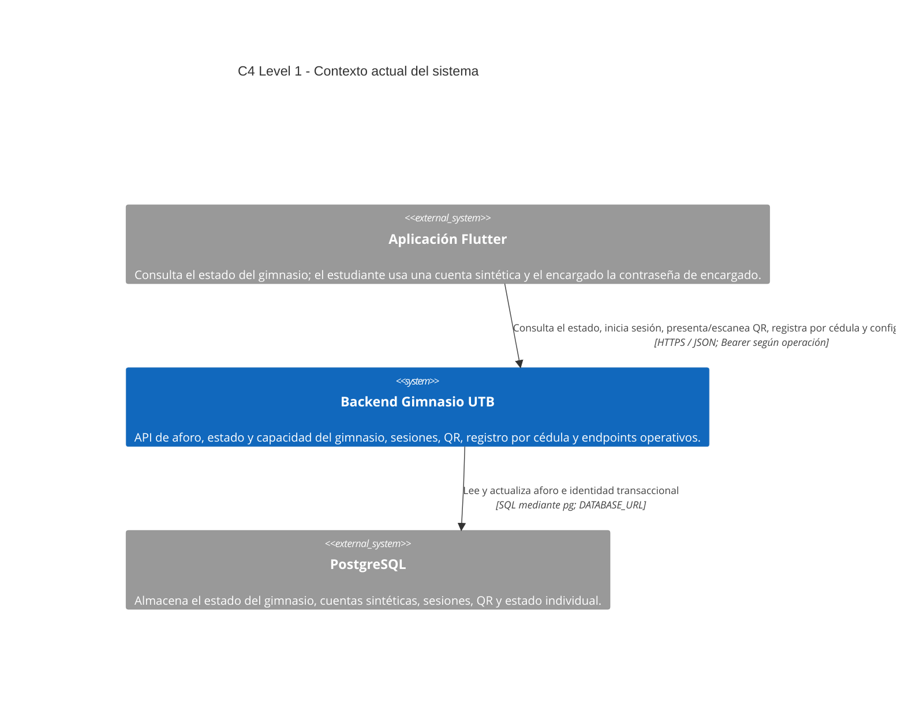

## Arquitectura objetivo / futura

**No implementado actualmente:** SSO institucional, roles individuales de encargados, historial completo, WebSocket y FCM. La apertura/cierre y la capacidad máxima ya están implementadas (ADR-0012). Las cuentas disponibles son sintéticas y no representan identidad UTB.
