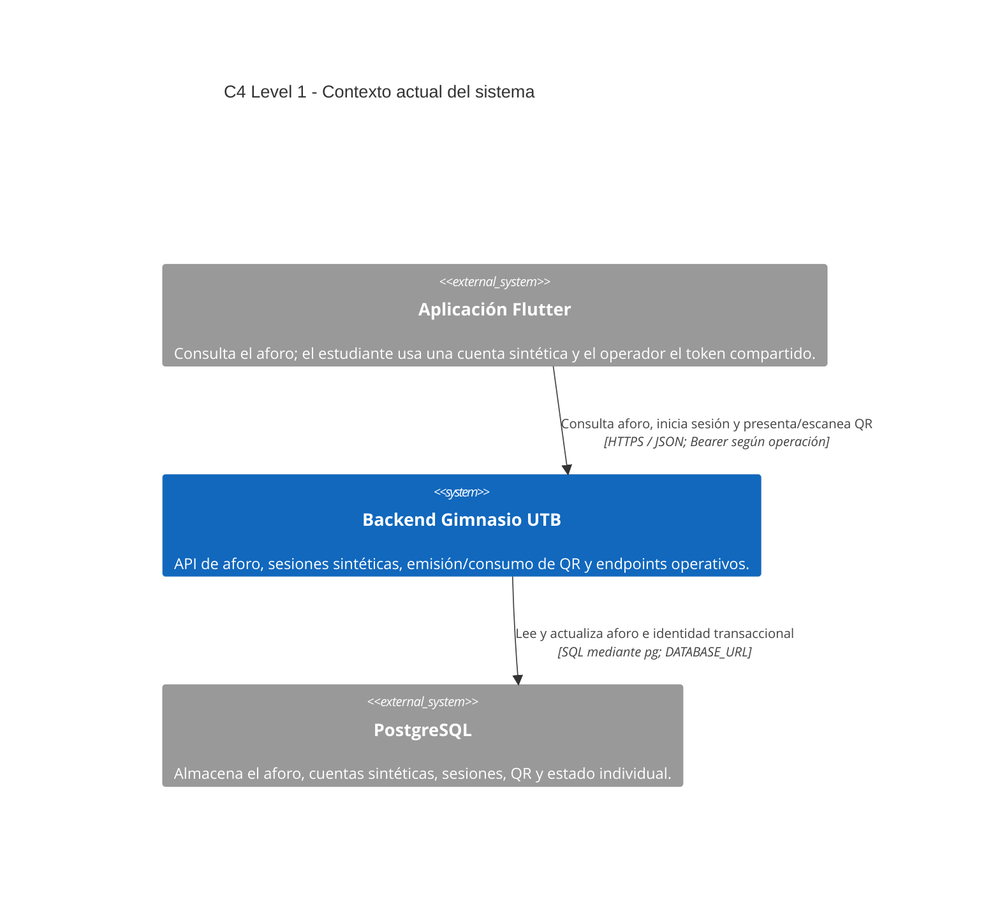

## Arquitectura objetivo / futura

**No implementado actualmente:** SSO institucional, roles individuales de encargados, apertura/cierre del gimnasio, historial completo, WebSocket y FCM. Las cuentas disponibles son sintéticas y no representan identidad UTB.
