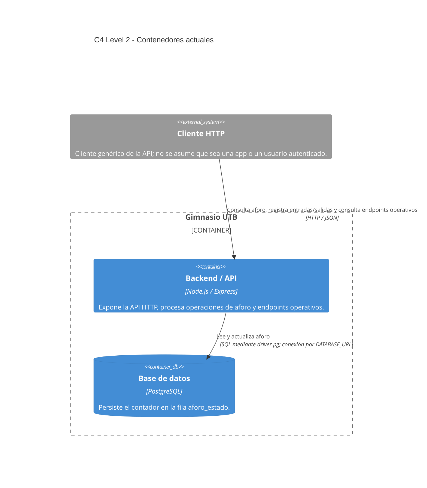
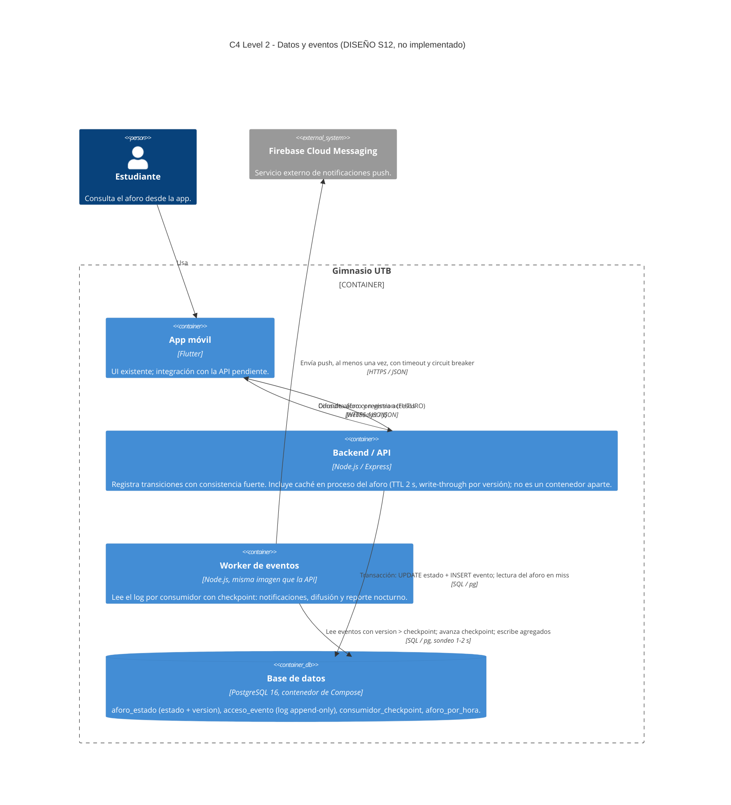

## Contenedores y evidencia

- **Backend / API:** el proceso real se inicia desde `src/server.js`; usa Express y compone `AforoPostgresAdapter`. La aplicación expone las rutas del módulo de aforo y `/health`, `/ready` y `/metrics`.
- **PostgreSQL:** `src/modules/aforo/infrastructure/persistence/schema.sql` crea `aforo_estado`, con una única fila permitida para el contador y restricción de valor no negativo.
- **Adapters internos:** `AforoPostgresAdapter` es la implementación usada por el servidor real. `AforoMemoriaAdapter` es una alternativa inyectable y se usa por defecto en `createApp()` para pruebas sin PostgreSQL. Ninguno es un contenedor separado.
- El adapter PostgreSQL realiza transacciones con bloqueo de fila; el detalle pertenece a la vista de componentes/ejecución, no representa un servicio adicional.

## Contenedores de datos y eventos (S12) — DISEÑO

Este diagrama muestra la arquitectura objetivo de la [evidencia S12](../s12-datos-eventos.md). **No describe el sistema actual**: el diagrama de arriba sigue siendo el vigente.

### Almacenes de datos y brokers

| Almacén | Tipo | ¿Contenedor propio? | Estado |
|---|---|---|---|
| PostgreSQL (`aforo_estado`) | Base relacional, fuente de verdad del invariante | **Sí** (servicio `postgres` en Compose) | IMPLEMENTADO |
| Log `acceso_evento` + `consumidor_checkpoint` | Log append-only dentro de PostgreSQL | No: son tablas del mismo contenedor. Se nombran en su descripción para que sean visibles. | DISEÑO (ADR-0006) |
| `aforo_por_hora` | Datos derivados para reportes | No: tabla del mismo contenedor | FUTURO |
| Caché del aforo | Memoria del proceso `api` | No: componente interno de la API | DISEÑO |
| Broker de mensajes | — | **No existe.** El log en PostgreSQL cumple su papel (ADR-0005, ADR-0006). | No aplica |

El worker sí es un contenedor propio en este diseño: es otro proceso con su propio ciclo de vida, aunque use la misma imagen. La relación `api → app` por WebSocket sale de la API porque es quien mantiene las conexiones.

## Arquitectura objetivo / futura

**No implementado actualmente:** aplicación Flutter, identidad/autenticación/roles, QR, historial, deduplicación, WebSocket, FCM, Render, PostgreSQL gestionado e infraestructura como código. No son contenedores ni conexiones del sistema actual.
