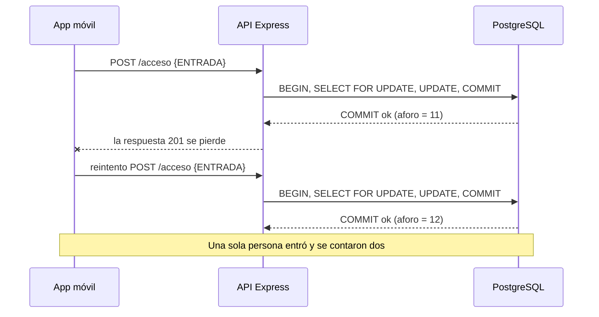

# Evidencia S11 — Fallos parciales y decisión de extracción

Este documento analiza qué puede fallar **a medias** en las integraciones reales del backend de Gimnasio UTB y cómo se mitiga. Sigue la convención del resto de la documentación:

- **IMPLEMENTADO**: existe en el código y tiene prueba.
- **DISEÑO**: decisión técnica descrita aquí, todavía no implementada. No se presenta como capacidad existente.
- **FUTURO**: depende de un módulo que aún no existe (Notificaciones, Identidad).

La decisión de extraer o no un módulo a servicio está en [ADR-0005](adr/0005-no-extraer-notificaciones.md).

## 1. Integraciones que pueden fallar parcialmente

Aunque el backend es un monolito, ya hay límites de red. Un fallo parcial es aquel en el que una parte del sistema funciona y otra no, y quien llama no sabe con certeza qué pasó.

| ID | Integración | Protocolo | Estado |
|---|---|---|---|
| I1 | App móvil / cliente HTTP → proxy de Dokploy → API Express | HTTPS hasta el proxy, HTTP interno puerto 3000 | IMPLEMENTADO (API); la app Flutter no está integrada todavía |
| I2 | API → PostgreSQL | Driver `pg`, `DATABASE_URL`, red interna de Docker Compose | IMPLEMENTADO |
| I3 | Aforo → Firebase Cloud Messaging (push) | HTTP/JSON hacia un tercero | FUTURO (contexto Notificaciones) |
| I4 | Aforo → Identidad (validar QR del estudiante) | Llamada interna del monolito hoy; red si se extrajera | FUTURO |

## 2. Tabla de modos de fallo y mitigación

| # | Int. | Modo de fallo | Qué pasa hoy (evidencia en el código) | Impacto | Táctica de mitigación | Estado |
|---|---|---|---|---|---|---|
| F1 | I1 | **Respuesta perdida después del `COMMIT`**: la transacción se confirma, pero la respuesta `201` no llega (red móvil, timeout del cliente o del proxy). El cliente reintenta. | `POST /api/v1/aforo/acceso` no es idempotente: cada llamada ejecuta una transición nueva (`registrar-acceso.usecase.js`). Dos llamadas = dos incrementos. | **Alto.** El contador queda inflado y no hay historial para corregirlo. Es el dato principal del producto. | Clave de idempotencia (`Idempotency-Key`) registrada en la **misma transacción** que el `UPDATE` (sección 3). | DISEÑO |
| F2 | I1 | **Reintentos ciegos**: ante `503` o timeout, el cliente reintenta de inmediato y varias veces. | No hay política de reintentos definida para el cliente; el servidor no envía `Retry-After`. | Medio. Amplifica la carga justo cuando la base está en problemas (efecto manada) y, sin F1 resuelto, duplica conteos. | Reintentos con **retroceso exponencial y jitter**, máximo 3, solo sobre errores transitorios y siempre con la misma clave de idempotencia (sección 3.6). `Retry-After` en los `503`. | DISEÑO |
| F3 | I2 | **PostgreSQL no responde** (contenedor caído, red interna, pool agotado). | Los errores de `pg` se traducen a `AforoRepositoryError` → `503` (IMPLEMENTADO). Pero el `Pool` se crea sin `connectionTimeoutMillis`; en `pg-pool` el valor por defecto es sin límite, así que `pool.connect()` puede **esperar indefinidamente** si el pool está agotado. | Alto. Peticiones colgadas, conexiones HTTP abiertas, el cliente termina reintentando (F1/F2). | **Timeouts** en el pool: `connectionTimeoutMillis`, `statement_timeout`, `query_timeout`. Fallar rápido con `503` + `Retry-After`. `/ready` ya saca la instancia del balanceo. | PARCIAL: `503` y `/ready` IMPLEMENTADOS; timeouts en DISEÑO |
| F4 | I2 | **Contención del bloqueo**: todas las escrituras compiten por la única fila de `aforo_estado` (`SELECT ... FOR UPDATE`). Una transacción lenta retiene el bloqueo. | El bloqueo serializa correctamente (prueba de 20 concurrentes, ADR-0004), pero no hay `lock_timeout`: una espera larga no se corta. | Medio en hora pico. Latencia alta, no inconsistencia. | `lock_timeout` + `statement_timeout`; transacción corta (ya lo es: 1 lectura, 1 escritura). Si en el futuro se demuestra cuello de botella, revaluar ADR-0004. | DISEÑO |
| F5 | I2 | **Resultado incierto del `COMMIT`**: la conexión se corta justo después de enviar `COMMIT`. La API no sabe si se confirmó. | El adapter propaga el error → `503`. Pero el `COMMIT` pudo haberse aplicado. El cliente ve "falló" y reintenta. | Alto. Es el mismo efecto que F1, visto desde el servidor. | La misma clave de idempotencia: el reintento encuentra la clave guardada si el `COMMIT` sí se aplicó, y la transición no se repite. | DISEÑO |
| F6 | I2 | **El proceso API muere a mitad de la transacción** (crash, `SIGKILL`). | PostgreSQL revierte toda transacción sin `COMMIT` (atomicidad). Las métricas en memoria se pierden. | Bajo para el contador. | Atomicidad de PostgreSQL + `ROLLBACK` explícito en el adapter. Métricas en memoria: riesgo aceptado (arc42 §11). | IMPLEMENTADO |
| F7 | I1 | **Redeploy con peticiones en vuelo**: Dokploy reemplaza el contenedor. | `SIGTERM` deja de aceptar conexiones y drena antes de cerrar el pool (IMPLEMENTADO). Si el drenaje se corta, el cliente no recibe respuesta → F1. | Medio. | Cierre ordenado (existente) + idempotencia para cubrir lo que el drenaje no alcance. | PARCIAL |
| F8 | I3 | **Escritura doble**: se confirma el cambio de aforo y luego falla el envío del push (o se envía el push y luego la transacción revierte). | No existe Notificaciones. | Alto cuando exista: notificaciones perdidas o "fantasma" sobre un aforo que no ocurrió. | **Patrón outbox**: el evento se guarda en la misma transacción del aforo y un *relay* lo publica después (sección 4). | FUTURO / DISEÑO |
| F9 | I3 | **FCM lento o caído**. | No existe Notificaciones. | Alto si se llamara a FCM dentro de la petición: el registro de acceso fallaría por culpa de un tercero (fallo en cascada). | No llamar a FCM en la ruta de la petición (outbox). En el relay: timeout + **circuit breaker** + reintento con retroceso (sección 4.3). | FUTURO / DISEÑO |
| F10 | I3 | **Entrega duplicada del relay**: el push sale, pero el relay muere antes de marcar el evento como enviado; al reiniciar lo envía otra vez (entrega "al menos una vez"). | No existe Notificaciones. | Bajo-medio: el estudiante recibe dos avisos. | Consumidor idempotente: cada evento tiene `id`; Notificaciones registra los ids enviados y descarta repetidos. | FUTURO / DISEÑO |
| F11 | I4 | **Identidad no responde** al validar un QR (si fuera un servicio separado). | No existe Identidad. Hoy sería una llamada dentro del mismo proceso, sin red. | Alto si estuviera por red: no se podría registrar ninguna entrada. | Mientras sea módulo del monolito, el modo de fallo no existe. Si se extrajera: timeout, circuit breaker y una **saga** con compensación (sección 5). Este costo es uno de los argumentos de ADR-0005. | FUTURO |

### Por qué no se pone un circuit breaker entre la API y PostgreSQL

Un circuit breaker sirve cuando hay una alternativa útil al fallar rápido (devolver un valor por defecto, seguir con funcionalidad degradada) o cuando hay que proteger a una dependencia de una avalancha de llamadas. Para I2 no hay alternativa: sin PostgreSQL no se puede registrar ni consultar el aforo, y el estado no puede inventarse. Con timeouts cortos (F3) la API ya falla rápido y `/ready` saca la instancia. Un breaker aquí agregaría estado y configuración sin cambiar el resultado para el usuario. Donde **sí** aporta es en I3 (FCM), porque el registro de acceso puede seguir funcionando aunque las notificaciones estén caídas.

## 3. Diseño de idempotencia para `POST /api/v1/aforo/acceso`

**Estado: DISEÑO.** No está implementado. Resuelve F1, F5 y la parte de F7 que el drenaje no cubre.

### 3.1 El problema en una línea de tiempo



El cliente no puede distinguir "no se registró" de "se registró pero no me enteré". Por eso el servidor debe reconocer el reintento.

### 3.2 Contrato

- El cliente genera un **UUID v4 por cada operación intencional** (un escaneo, un toque en "registrar entrada") y lo envía en la cabecera `Idempotency-Key`.
- Todos los reintentos de esa operación reutilizan **la misma** clave. Una operación nueva usa una clave nueva.
- Respuestas:

| Situación | Respuesta |
|---|---|
| Clave nueva | Se aplica la transición. `201` con `{ aforoActual }`. |
| Clave ya registrada con el mismo `tipoAcceso` | **No** se aplica de nuevo. `201` con el `aforoActual` que resultó la primera vez y la cabecera `Idempotency-Replayed: true`. |
| Clave ya registrada con otro `tipoAcceso` | `422`: la clave se reutilizó para una operación distinta (error del cliente). |
| Clave con formato inválido | `400`. |
| Sin clave | Compatibilidad con v1: se procesa como hoy, sin garantía, y se registra un log `warn`. Hacerla obligatoria es un cambio incompatible y requiere `v2` del contrato (coherente con la estrategia de versionado de S7). |

El cambio en v1 es **aditivo** (una cabecera opcional nueva), por lo que no rompe a los clientes existentes ni la prueba de contrato actual.

### 3.3 Almacenamiento

```sql
CREATE TABLE IF NOT EXISTS solicitud_acceso (
  clave            UUID PRIMARY KEY,
  tipo_acceso      TEXT NOT NULL CHECK (tipo_acceso IN ('ENTRADA', 'SALIDA')),
  aforo_resultante INTEGER NOT NULL,
  creada_en        TIMESTAMPTZ NOT NULL DEFAULT now()
);
```

La tabla pertenece al contexto Aforo (respeta la tabla módulo → dato → dueño de S6). Se depuran las claves con más de 24 horas; ese plazo debe ser mayor que la ventana total de reintentos del cliente (sección 3.6).

### 3.4 Algoritmo dentro de la transacción

```text
BEGIN
SELECT aforo_actual FROM aforo_estado WHERE id = 1 FOR UPDATE    -- serializa todas las escrituras
SELECT tipo_acceso, aforo_resultante FROM solicitud_acceso WHERE clave = $clave
  si existe y tipo_acceso = $tipo   -> ROLLBACK; devolver aforo_resultante (repetición)
  si existe y tipo_acceso <> $tipo  -> ROLLBACK; error 422
nuevo = aplicarAcceso(aforo_actual, $tipo)                         -- dominio puro, sin cambios
UPDATE aforo_estado SET aforo_actual = nuevo WHERE id = 1
INSERT INTO solicitud_acceso (clave, tipo_acceso, aforo_resultante) VALUES ($clave, $tipo, nuevo)
COMMIT
```

**La decisión clave es guardar la clave en la misma transacción que el `UPDATE`.** Si se guardara aparte (otra transacción, caché en memoria, Redis) habría un instante en que el contador cambió y la clave no existe, o al revés; un crash en ese instante rompe la garantía. Dentro de una transacción, ambos se confirman o ninguno.

### 3.5 Por qué funciona: casos

| Caso | Resultado |
|---|---|
| F1: el `COMMIT` se aplicó y la respuesta se perdió | El reintento encuentra la clave → devuelve el mismo resultado sin incrementar. |
| La API murió antes del `COMMIT` | PostgreSQL revirtió todo, la clave no existe → el reintento se procesa como nuevo. Correcto: la primera vez no ocurrió. |
| F5: `COMMIT` incierto | Si se aplicó, el reintento encuentra la clave; si no, la procesa. En ambos casos el contador queda bien. |
| Dos peticiones con la misma clave a la vez | La segunda espera en `FOR UPDATE`; cuando obtiene el bloqueo, la primera ya confirmó y la clave existe → repetición. La `PRIMARY KEY` es una segunda barrera. |
| `SALIDA` rechazada por aforo en cero | La transacción revierte y la clave **no** se guarda. Un reintento se evalúa de nuevo; si entre tanto hubo una entrada, la salida podrá aceptarse. Es aceptable: el rechazo no cambió estado. |

El dominio (`aplicarAcceso`) no cambia: la idempotencia es una preocupación de infraestructura y se resuelve en el adapter, como pide ADR-0001.

### 3.6 Política de reintentos del cliente

| Parámetro | Valor propuesto | Motivo |
|---|---|---|
| Timeout por intento | 5 s | Mayor que la suma de timeouts del servidor (sección 3.7), para no abandonar peticiones que el servidor todavía puede completar. |
| Reintentos máximos | 3 (4 intentos en total) | Suficiente para cortes cortos de red móvil sin insistir indefinidamente. |
| Retroceso | `espera = aleatorio(0, 500 ms × 2^intento)` (exponencial con *full jitter*) | El exponencial da tiempo a recuperarse; el jitter evita que todos los teléfonos reintenten en el mismo instante. |
| Cuándo reintentar | Error de red, timeout, `502`, `503`, `504` | Son transitorios. |
| Cuándo **no** reintentar | `400`, `422`, `201` | Un error de validación no se arregla repitiendo. |
| `Retry-After` | Si llega, se respeta como espera mínima | El servidor conoce mejor su estado. |
| Clave | Siempre la misma en todos los reintentos de una operación | Sin esto, reintentar es peligroso (F1). |

Ventana total en el peor caso ≈ 4 × 5 s + 0,5 + 1 + 2 s ≈ 24 s, muy por debajo de las 24 h de retención de claves.

### 3.7 Timeouts del servidor (para F3 y F4)

Configuración propuesta del `Pool` en `AforoPostgresAdapter`:

| Opción | Valor | Qué corta |
|---|---|---|
| `connectionTimeoutMillis` | 2000 | Espera por una conexión del pool (hoy sin límite). |
| `lock_timeout` | 2000 ms | Espera por el bloqueo de la fila de aforo (F4). |
| `statement_timeout` | 3000 ms | Una sentencia SQL que tarda demasiado. |
| `query_timeout` | 4000 ms | Corte del lado del cliente `pg` si el servidor no contesta. |

Todos producen errores de `pg` que el adapter ya convierte en `AforoRepositoryError`, por lo que el router responde `503` sin cambios de flujo. Solo se agrega la cabecera `Retry-After: 2`. Los valores son punto de partida; se ajustan cuando haya medición de latencia real.

### 3.8 Qué cambiaría en el código al implementarlo

| Archivo | Cambio |
|---|---|
| `schema.sql` | Tabla `solicitud_acceso`. |
| `aforo-repository.port.js` | `actualizarAforo(transicionar, { clave, tipoAcceso })`: segundo parámetro opcional. |
| `aforo-postgres.adapter.js` | Consulta e inserción de la clave dentro de `transicionarEnTransaccion`; timeouts del pool. |
| `aforo-memoria.adapter.js` | Un `Map` de claves con la misma semántica, para las pruebas sin base de datos. |
| `aforo.router.js` | Leer y validar `Idempotency-Key`; `Idempotency-Replayed`; `422`; `Retry-After` en `503`. |
| `docs/openapi.yaml` | Cabecera opcional y respuesta `422`. |
| Pruebas | (1) mismo POST dos veces con la misma clave → aforo +1; (2) misma clave con otro tipo → `422`; (3) 20 peticiones concurrentes con la misma clave → aforo +1 (PostgreSQL); (4) prueba de contrato del nuevo campo. |

## 4. Notificaciones: outbox y circuit breaker

**Estado: FUTURO / DISEÑO.** Aplica cuando se implemente el contexto Notificaciones. Se diseña ahora porque la decisión de ADR-0005 depende de que exista una forma de aislar los fallos de FCM sin extraer el módulo.

### 4.1 Patrón outbox

```sql
CREATE TABLE IF NOT EXISTS outbox_evento (
  id               BIGSERIAL PRIMARY KEY,
  tipo             TEXT NOT NULL,          -- p. ej. 'AforoActualizado' (nombre provisional)
  payload          JSONB NOT NULL,
  creado_en        TIMESTAMPTZ NOT NULL DEFAULT now(),
  enviado_en       TIMESTAMPTZ,
  intentos         INTEGER NOT NULL DEFAULT 0,
  proximo_intento  TIMESTAMPTZ NOT NULL DEFAULT now()
);
```

1. En la **misma transacción** del registro de acceso se hace `INSERT INTO outbox_evento`. Si la transacción revierte, el evento tampoco existe (resuelve F8).
2. Un *relay* (proceso del mismo código, ver ADR-0005) lee pendientes cada pocos segundos:
   `SELECT ... WHERE enviado_en IS NULL AND proximo_intento <= now() ORDER BY id LIMIT 50 FOR UPDATE SKIP LOCKED`.
   `SKIP LOCKED` permite tener más de un relay sin que procesen el mismo evento a la vez.
3. Por cada evento llama al adaptador de notificaciones; si funciona, marca `enviado_en`; si falla, suma `intentos` y programa `proximo_intento` con retroceso exponencial.
4. La entrega es **al menos una vez** (F10): el consumidor descarta ids repetidos.

Qué regla decide a quién notificar (umbral de ocupación, preferencias del estudiante) pertenece a Notificaciones y está pendiente de definirse; el outbox no depende de esa regla.

### 4.2 Por qué no basta con "guardar y después enviar" en el mismo handler

Si el handler hace `COMMIT` y luego llama a FCM, un crash entre ambos pierde la notificación para siempre, y si FCM tarda, el estudiante que escaneó el QR espera por un tercero. El outbox convierte una escritura doble (base + FCM) en una sola escritura local más un trabajo que se puede reintentar.

### 4.3 Circuit breaker en el relay

| Estado | Comportamiento | Parámetros propuestos |
|---|---|---|
| Cerrado | Llama a FCM normalmente, timeout de 3 s por llamada. | Pasa a abierto con 5 fallos consecutivos o ≥ 50 % de fallos en las últimas 20 llamadas. |
| Abierto | No llama a FCM. Los eventos quedan pendientes en el outbox (no se pierden). | Permanece 30 s. |
| Semiabierto | Deja pasar 1 llamada de prueba. | Éxito → cerrado. Fallo → abierto otra vez. |

Gracias al outbox, abrir el circuito no pierde datos: solo retrasa los avisos. El registro de accesos sigue funcionando.

## 5. ¿Aplica una saga?

**Hoy no.** Todas las escrituras de un registro de acceso viven en una sola base de datos y se resuelven con **una transacción ACID local** (ADR-0004). Aun cuando se implementen Identidad y Notificaciones como módulos del monolito, compartirán esa base y la transacción seguirá alcanzando. Usar una saga donde basta una transacción agrega estados intermedios visibles y compensaciones sin beneficio.

### 5.1 Escenario hipotético: si Identidad y Aforo fueran servicios separados

Se describe para dimensionar el costo de extraer (insumo de ADR-0005). Operación: "registrar entrada con QR". Saga **orquestada** por Aforo, con un `idSaga` que actúa también como clave de idempotencia en cada paso:

| Paso | Servicio | Acción | Compensación si un paso posterior falla |
|---|---|---|---|
| T1 | Identidad | Validar el QR y marcar al estudiante como "dentro". | C1: quitar la marca "dentro" de ese estudiante para ese `idSaga`. |
| T2 | Aforo | Incrementar el contador (puede rechazar si se define un cupo máximo). | — (último paso compensable) |
| T3 | Notificaciones | Publicar evento vía outbox. | No se compensa: es posterior al punto sin retorno y se reintenta hasta que se entregue. |

Si T2 falla, el orquestador ejecuta C1. Si C1 también falla, se reintenta con retroceso, porque la compensación debe terminar. Durante la saga existe un estado intermedio visible ("dentro" en Identidad sin contar en Aforo), es decir, **consistencia eventual**, algo que hoy no existe.

Este escenario exige: estado de saga persistido, compensaciones idempotentes, reintentos, monitoreo de sagas atascadas y trazas entre servicios. Ninguno es necesario mientras los módulos compartan proceso y base de datos.

## 6. Trazabilidad

| Elemento | Dónde |
|---|---|
| Decisión de extracción | [ADR-0005](adr/0005-no-extraer-notificaciones.md) |
| Riesgos actualizados | [arc42 §11](arc42/arc42_gimnasio_utb.md#11-riesgos-y-deuda-técnica) |
| Concurrencia del contador | [ADR-0004](adr/0004-concurrencia-postgresql.md) |
| Integración síncrona | [ADR-0003](adr/0003-comunicacion-sincrona-asincrona.md) |
| Propiedad de datos por contexto | [Contextos delimitados](contextos-delimitados.md) |
| Uso de IA en esta evidencia | [docs/ia.md — Semana 11](ia.md) |
