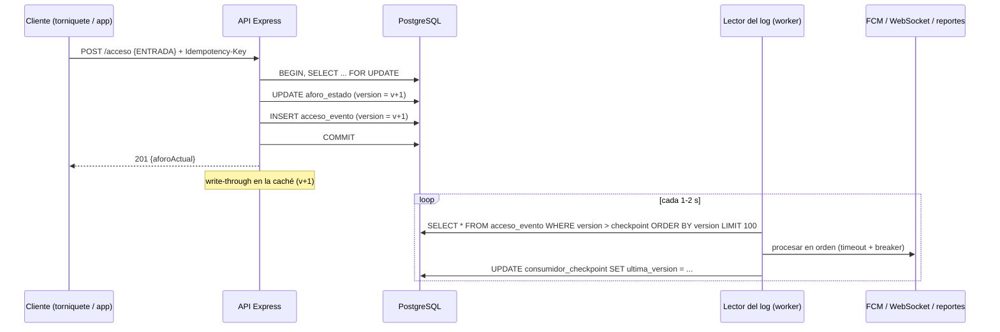

# Evidencia S12 — Estrategia de datos y eventos

Este documento decide **qué garantía de consistencia necesita cada operación** de Gimnasio UTB, cómo se cachea la lectura del aforo sin romper esas garantías y cómo se modela el flujo por eventos que alimentará notificaciones, tiempo real y reportes. Sigue la convención del resto de la documentación:

- **IMPLEMENTADO**: existe en el código y tiene prueba.
- **DISEÑO**: decisión técnica descrita aquí, todavía no implementada.
- **FUTURO**: depende de un módulo que aún no existe (Identidad, Gestión Operativa, Notificaciones, WebSocket).

La decisión de datos más costosa de revertir está en [ADR-0006](adr/0006-log-de-eventos-de-acceso.md). La estrategia resumida está en [arc42 §8](arc42/arc42_gimnasio_utb.md#8-conceptos-transversales) y los almacenes de datos en el [C4 nivel 2](c4/c4_level2.md).

**Resumen de decisiones**

1. Solo las **escrituras** sobre el aforo (y lo que debe quedar atado a ellas) necesitan consistencia fuerte. Las **lecturas** de la app toleran un atraso acotado de pocos segundos.
2. La lectura del aforo se cachea **en el proceso de la API**, con escritura directa (*write-through*) protegida por versión y un TTL de 2 s como red de seguridad. No se agrega Redis ni caché HTTP.
3. Cada transición se anexa a un **log de eventos append-only en PostgreSQL** dentro de la misma transacción. Ese log es a la vez historial, registro de idempotencia y fuente de eventos para los consumidores (ADR-0006). No se agrega un broker.

---

## 1. Escenarios de calidad que fijan la garantía

La garantía no se elige por gusto: sale de lo que cada escenario necesita de verdad.

| ID | Escenario | Qué exige | Estado |
|---|---|---|---|
| Q1 | **S1 — Concurrencia del contador**: 20 entradas concurrentes terminan en 20; el aforo nunca es negativo. | Que dos escrituras no lean el mismo valor (sin *lost updates*) y que la regla `aforo ≥ 0` se evalúe sobre el valor real. | IMPLEMENTADO (ADR-0004, prueba PostgreSQL) |
| Q2 | **Reintento seguro** (F1/F5 de S11): un reintento del cliente no cuenta dos veces. | Que la clave de idempotencia se confirme junto con el cambio de aforo. | DISEÑO (S11) |
| Q3 | **Frescura de la consulta** (nuevo): el aforo que entrega la API no tiene más de **2 s de atraso** respecto al último `COMMIT`. | Atraso acotado, no lectura del último valor exacto. Un estudiante decide si caminar al gimnasio; 2 s no cambian esa decisión. | OBJETIVO no medido |
| Q4 | **Trazabilidad del conteo** (nuevo): ante una queja ("dice 40 y hay 15"), se puede reconstruir qué transiciones llevaron al valor actual. | Que cada transición confirmada quede registrada, en orden, sin huecos. | DISEÑO (ADR-0006) |
| Q5 | **Aislamiento de terceros** (F9 de S11): si FCM falla, el registro de accesos sigue funcionando. | Que las notificaciones sean asíncronas y no estén en la ruta de la petición. | FUTURO / DISEÑO |

## 2. El espectro de consistencia aplicado

De más fuerte a más débil, y lo que cada punto le exige al resto del sistema:

| Punto del espectro | Qué promete | Qué cuesta en este sistema |
|---|---|---|
| **Fuerte (serializable sobre la fila)** | Toda escritura ve el último valor confirmado; las escrituras se ordenan una tras otra. | Una sola fuente de verdad (`aforo_estado`), transacción con `SELECT ... FOR UPDATE`, contención en hora pico (F4) y **no se puede escribir si PostgreSQL no responde** (se prefiere `503` a contar mal). |
| **De sesión (leer lo propio)** | Quien escribe ve su propia escritura en la siguiente lectura. | Devolver el resultado en la respuesta del `POST` o actualizar la caché de la instancia que atendió la escritura. |
| **Eventual con atraso acotado** | La lectura puede estar atrasada, pero nunca más de *X* segundos, y no retrocede dentro de una instancia. | Una caché con TTL y una versión monótona para no retroceder. |
| **Eventual sin cota** | Converge "en algún momento". | Solo es aceptable para datos operativos sin decisiones encima (`/metrics`). |

La pregunta de la semana se responde así: **lo caro (fuerte) se reserva para el invariante del contador**; todo lo que solo *muestra* o *reacciona* al contador baja en el espectro y se paga con mecanismos más baratos.

## 3. Tabla operación → garantía de consistencia

| # | Operación | Contexto | Estado | Escenario | Garantía elegida | Mecanismo | Qué le exige al resto |
|---|---|---|---|---|---|---|---|
| O1 | Registrar `ENTRADA`/`SALIDA` (`POST /api/v1/aforo/acceso`) | Aforo | IMPLEMENTADO | Q1 | **Fuerte**: serializable sobre la fila `aforo_estado` | `BEGIN` → `SELECT ... FOR UPDATE` → `aplicarAcceso` → `UPDATE` → `COMMIT` | Transacción corta; PostgreSQL disponible (si no, `503`: se elige consistencia sobre disponibilidad). |
| O2 | Reintento con `Idempotency-Key` | Aforo | DISEÑO (S11) | Q2 | **Fuerte**: efecto exactamente una vez | Clave única guardada en la misma transacción que O1 (en ADR-0006 pasa a ser una columna del log) | El cliente genera un UUID por operación y lo reutiliza en los reintentos. |
| O3 | Anexar el evento `AccesoRegistrado` al log | Aforo | DISEÑO (ADR-0006) | Q4 | **Fuerte y atómica con O1**: el evento existe si y solo si la transición se confirmó | `INSERT INTO acceso_evento` dentro de la transacción de O1 | Un `INSERT` más mientras se tiene el bloqueo (se alarga un poco F4). |
| O4 | Respuesta al que registra (torniquete, encargado) | Aforo | IMPLEMENTADO | Q1 | **De sesión**: lee su propia escritura | El `201` devuelve `aforoActual` del `COMMIT`; con caché, la escritura actualiza la entrada de esa instancia | Nada adicional. |
| O5 | Consultar aforo desde la app (`GET /api/v1/aforo`) | Aforo (lectura) | IMPLEMENTADO sin caché; caché en DISEÑO | Q3 | **Eventual con atraso ≤ 2 s** y sin retroceso dentro de una instancia | Caché en proceso, TTL 2 s, *write-through* con guarda de versión (sección 4) | Que el repositorio devuelva una `version` monótona junto al valor. |
| O6 | Readiness (`GET /ready`) | Operación | IMPLEMENTADO | — | **Fuerte**: lectura directa | Llama al repositorio real, **nunca a la caché** | Si pasara por la caché, `/ready` diría "listo" con PostgreSQL caído. |
| O7 | Difundir el aforo por WebSocket | Aforo → clientes | FUTURO | Q3 | **Eventual + monótona** (un cliente nunca ve un valor más viejo que el que ya vio) | Consumidor del log; el cliente descarta mensajes con `version` ≤ la última vista | Orden total del log (sección 5.4). |
| O8 | Notificación push "hay cupo" | Notificaciones | FUTURO | Q5 | **Eventual** (segundos a minutos), entrega **al menos una vez**, en orden | Consumidor del log con checkpoint durable, timeout y circuit breaker (S11 §4.3) | Consumidor idempotente por `version` del evento. |
| O9 | Abrir/cerrar el gimnasio | Gestión Operativa | FUTURO | — | **Fuerte** al escribir y al validar un registro (O1 lee el estado en su transacción) | Fila de estado en la misma base | Mismo patrón que O1. La lectura para la app puede cachearse igual que O5. |
| O10 | Corrección manual de un conteo por el encargado | Gestión Operativa → Aforo | FUTURO | Q4 | **Fuerte**, y **nunca edita** eventos pasados | Se anexa un evento de ajuste (`origen = 'MANUAL'`) en una transacción como O1 | El log es append-only. |
| O11 | Reportes de ocupación por hora para Bienestar | Reportes | FUTURO | — | **Eventual, T + 1 día** | Pipeline nocturno idempotente sobre el log (sección 6) | Retención del log suficiente para recalcular. |
| O12 | `GET /metrics` | Operación | IMPLEMENTADO | — | **Ninguna** (mejor esfuerzo por proceso) | Contador en memoria; se pierde al reiniciar | Riesgo aceptado (arc42 §11.2). |

**Lectura de la tabla:** solo O1, O2, O3, O9 y O10 pagan consistencia fuerte, y todas viven en la misma base y en transacciones locales; por eso no hace falta saga ni transacción distribuida (coherente con S11 §5). El resto baja en el espectro de forma explícita.

## 4. Diseño de caché

**Estado: DISEÑO.** No hay caché en el código actual: cada `GET /api/v1/aforo` consulta PostgreSQL.

### 4.1 ¿Hace falta?

Honestamente, **con la carga actual no**: no hay app integrada ni mediciones. La lectura es de una sola fila y, por el MVCC de PostgreSQL, un `SELECT` normal **no espera** al bloqueo `FOR UPDATE` de las escrituras.

El problema aparece en hora pico, cuando se integre la app. Supuesto no medido: 300 estudiantes con la app abierta consultando cada 10 s son unas **30 lecturas por segundo**, frente a unas pocas escrituras por minuto. Cada lectura ocupa una conexión del pool (10 por defecto). Si las escrituras se encolan en el bloqueo (F4), retienen conexiones, y las lecturas pueden quedarse sin conexión (F3) aunque el dato se pueda leer. La caché desacopla las lecturas del pool en ese momento.

Se diseña ahora para que la política de invalidación no se improvise cuando haga falta, y se implementa cuando la app consuma la API o una medición muestre presión sobre el pool.

### 4.2 Qué se cachea y qué no

| Dato | ¿Se cachea? | Motivo |
|---|---|---|
| Aforo actual (`GET /api/v1/aforo`) | **Sí** | Muchas lecturas, pocas escrituras, tolera 2 s de atraso (Q3). |
| Estado abierto/cerrado (FUTURO) | Sí, misma política | Cambia pocas veces al día. |
| Lectura dentro de una escritura (O1) | **No** | La regla `aforo ≥ 0` debe evaluarse sobre el valor real bloqueado. Cachear aquí rompería Q1. |
| `GET /ready` | **No** | Debe reflejar si PostgreSQL responde ahora. |
| Respuestas del `POST` | **No** | No son lecturas; la idempotencia (O2) se resuelve en la base, no en caché (S11 §3.4). |
| Identidad, QR, roles (FUTURO) | **No** | Una revocación debe aplicar de inmediato; cachearlos abre una ventana de acceso indebido. |

### 4.3 Dónde va la caché: opciones

| Opción | Ventaja | Por qué no (o sí) |
|---|---|---|
| **A. En el proceso de la API, como decorador del puerto** (elegida) | Cero infraestructura nueva; la invalidación por escritura es exacta en la instancia que escribe; encaja en la hexagonal: es otro adaptador de `AforoRepositoryPort`. | Con varias instancias, cada una tiene su caché; las demás se enteran por TTL. Por eso el atraso se acota con el TTL y no con la invalidación. |
| B. Caché HTTP (`Cache-Control: max-age` en el proxy o en el teléfono) | Quita carga antes de llegar a la API. | El servidor **no puede invalidar** una copia en el teléfono o en el proxy; los atrasos de cada capa se suman y la cota de Q3 deja de ser calculable. No se ha verificado cómo cachea el proxy de Dokploy. |
| C. Redis compartido | Una sola caché para varias instancias. | Hoy hay **una** instancia de `api`: Redis agrega un contenedor, una red y un modo de fallo (Redis caído) sin mejorar Q3. Se revisa si hay ≥ 2 instancias y 2 s de diferencia entre ellas deja de ser aceptable. |

### 4.4 Patrón y política de invalidación

Patrón: **lectura con caché (*cache-aside*) + escritura directa (*write-through*) con guarda de versión + TTL como red de seguridad + una sola lectura en vuelo (*single-flight*).**

Una entrada única, `aforo:actual = { aforoActual, version, guardadoEn }`. `version` es un entero que PostgreSQL incrementa en cada transición (ADR-0006).

| Evento | Acción sobre la caché | Por qué |
|---|---|---|
| Lectura con entrada vigente (edad < TTL) | Se devuelve la entrada. **Hit.** | Atraso ≤ TTL. |
| Lectura sin entrada o vencida | Va a PostgreSQL; si ya hay una lectura en vuelo, se espera esa misma promesa. Al volver, se guarda **solo si su `version` ≥ la guardada**. | Evita la avalancha al vencer el TTL y evita retroceder. |
| Escritura confirmada en esta instancia | Se **reemplaza** la entrada con el `{ aforoActual, version }` del `COMMIT`, **solo si su `version` > la guardada**. | Leer lo propio (O4) y caché exacta en la instancia que escribe. |
| Escritura rechazada por el dominio (`400`) | No se toca. | El estado no cambió (hubo `ROLLBACK`). |
| Error de repositorio en una escritura (`503`) | Se **borra** la entrada. | Resultado incierto (F5): el `COMMIT` pudo aplicarse. Mejor ir a la base en la siguiente lectura. |
| Escritura en otra instancia, SQL manual o `npm run db:init` | Esta instancia no se entera. | El **TTL de 2 s** acota el atraso. Es la razón por la que el TTL existe aunque haya invalidación. |
| Reinicio o redeploy del proceso | La caché arranca vacía. | Sin efecto en la consistencia; la primera lectura va a la base. |
| PostgreSQL caído y entrada vencida | **No** se sirve el valor viejo: `503` como hoy. | Servir un valor vencido cambiaría el contrato (habría que exponer su antigüedad). Se rechaza por ahora. |

### 4.5 Carreras y cómo se resuelven

| Carrera | Qué pasaría sin la guarda | Resolución |
|---|---|---|
| **Lectura lenta contra escritura.** Una lectura sale hacia la base y obtiene `v5 = 11`; mientras tanto se confirma `v6 = 12` y se guarda; la lectura vuelve tarde. | Con "borrar al escribir" (la idea inicial), la lectura tardía guardaría 11 y la caché quedaría atrasada hasta el TTL. | `v5 < v6`: la lectura tardía no sobrescribe. |
| **Escrituras que resuelven en otro orden.** Dos `COMMIT` (`v6`, `v7`) usan conexiones distintas; Node puede procesar sus respuestas en orden inverso. | La caché terminaría en `v6`, un valor más viejo. | `v6 < v7`: se descarta. |
| **Avalancha al vencer el TTL.** 30 peticiones llegan en el mismo instante sin entrada. | 30 consultas a la base, 30 conexiones del pool. | *Single-flight*: una sola consulta; las demás esperan su promesa. |
| **`COMMIT` incierto (F5).** | Se mantendría un valor posiblemente viejo. | Se borra la entrada. Riesgo residual: una lectura que salió antes del fallo puede volver y guardarse; queda acotado por el TTL. |

### 4.6 Parámetros

| Parámetro | Valor | Justificación |
|---|---|---|
| TTL | 2 s | Igual a la cota de Q3. Con una sola instancia, el TTL casi nunca decide (la escritura ya actualiza la caché); importa con varias instancias o escrituras externas. |
| Tamaño | 1 entrada (2 con estado operativo) | No hay política de expulsión que diseñar. |
| Reloj | Inyectable (`ahora = Date.now`) | Permite probar el vencimiento sin esperar. |

### 4.7 Qué le exige al resto del sistema

- El puerto devuelve la versión: `obtenerEstado()` y `actualizarAforo(...)` retornan `{ aforoActual, version }`. El contrato HTTP **no cambia** (sigue respondiendo `aforoActual`).
- El esquema agrega `aforo_estado.version` (ADR-0006).
- El *composition root* compone dos rutas: los casos de uso usan el repositorio **cacheado**; `/ready` usa el repositorio **real**.
- `/metrics` agrega `cache_hits` y `cache_misses` para comprobar que la caché sirve de algo.

### 4.8 Código propuesto (esbozo)

```js
// src/modules/aforo/infrastructure/persistence/aforo-cacheado.adapter.js (DISEÑO)
class AforoRepositoryCacheado extends AforoRepositoryPort {
  #repo; #ttlMs; #ahora;
  #entrada = null;          // { estado: { aforoActual, version }, guardadoEn }
  #lecturaEnCurso = null;   // single-flight

  constructor(repo, { ttlMs = 2000, ahora = Date.now } = {}) {
    super();
    this.#repo = repo; this.#ttlMs = ttlMs; this.#ahora = ahora;
  }

  async obtenerEstado() {
    if (this.#entrada && this.#ahora() - this.#entrada.guardadoEn < this.#ttlMs) {
      return this.#entrada.estado;                              // hit
    }
    this.#lecturaEnCurso ??= this.#repo.obtenerEstado()
      .then((estado) => { this.#guardar(estado); return estado; })
      .finally(() => { this.#lecturaEnCurso = null; });
    return this.#lecturaEnCurso;                                // miss (una sola consulta)
  }

  async actualizarAforo(transicionar, opciones) {
    try {
      const estado = await this.#repo.actualizarAforo(transicionar, opciones);
      this.#guardar(estado);                                    // write-through
      return estado;
    } catch (error) {
      if (error instanceof AforoRepositoryError) this.#entrada = null; // F5: incierto
      throw error;                                              // AforoDomainError: no se toca
    }
  }

  #guardar(estado) {
    if (this.#entrada && estado.version < this.#entrada.estado.version) return; // nunca retroceder
    this.#entrada = { estado, guardadoEn: this.#ahora() };
  }
}
```

El dominio y los casos de uso no cambian de responsabilidad: la caché es infraestructura, como pide ADR-0001.

### 4.9 Pruebas planeadas

1. Dos `obtenerEstado()` seguidos → el repositorio real se llama **una** vez.
2. `actualizarAforo` y luego `obtenerEstado()` → devuelve el nuevo valor **sin** llamar al repositorio.
3. Una lectura que vuelve con `version` menor a la guardada → no la sobrescribe.
4. Con reloj falso, al pasar 2 s → la siguiente lectura va al repositorio.
5. 50 lecturas concurrentes sin entrada → **una** llamada al repositorio.
6. `AforoRepositoryError` en una escritura → la entrada se borra; `AforoDomainError` → se conserva.
7. `/ready` con el repositorio real caído y la caché llena → `503`.

## 5. Flujo por eventos

**Estado: DISEÑO** (el log) y **FUTURO** (los consumidores). La decisión de tener el log está en [ADR-0006](adr/0006-log-de-eventos-de-acceso.md).

### 5.1 El evento `AccesoRegistrado`

```sql
ALTER TABLE aforo_estado ADD COLUMN version BIGINT NOT NULL DEFAULT 0;

CREATE TABLE IF NOT EXISTS acceso_evento (
  version          BIGINT PRIMARY KEY,                 -- = aforo_estado.version tras la transición
  tipo_acceso      TEXT NOT NULL CHECK (tipo_acceso IN ('ENTRADA', 'SALIDA')),
  aforo_resultante INTEGER NOT NULL CHECK (aforo_resultante >= 0),
  ocurrido_en      TIMESTAMPTZ NOT NULL DEFAULT now(),
  idempotency_key  UUID UNIQUE,                        -- NULL si el cliente no la envía (v1)
  origen           TEXT NOT NULL DEFAULT 'API'         -- FUTURO: 'QR', 'MANUAL'
);

CREATE TABLE IF NOT EXISTS consumidor_checkpoint (
  consumidor      TEXT PRIMARY KEY,                    -- 'notificaciones', 'reportes', ...
  ultima_version  BIGINT NOT NULL DEFAULT 0,
  actualizado_en  TIMESTAMPTZ NOT NULL DEFAULT now()
);
```

Transacción de registro (amplía S11 §3.4):

```text
BEGIN
SELECT aforo_actual, version FROM aforo_estado WHERE id = 1 FOR UPDATE
SELECT tipo_acceso, aforo_resultante FROM acceso_evento WHERE idempotency_key = $clave   -- O2
nuevo = aplicarAcceso(aforo_actual, $tipo)                                                -- dominio, sin cambios
UPDATE aforo_estado SET aforo_actual = nuevo, version = version + 1 WHERE id = 1 RETURNING version
INSERT INTO acceso_evento (version, tipo_acceso, aforo_resultante, idempotency_key) VALUES (...)
COMMIT
```

### 5.2 Diagrama del flujo



### 5.3 Garantías de entrega y de orden

| Garantía | Qué se promete | Cómo |
|---|---|---|
| **Producción** | Un evento existe **si y solo si** su transición se confirmó. No hay eventos fantasma ni transiciones sin evento. | Mismo `COMMIT` (resuelve F8 de S11). |
| **Persistencia** | Un evento confirmado no se pierde aunque se caiga la API o el worker. | Vive en PostgreSQL con el volumen del Compose. |
| **Entrega a cada consumidor** | **Al menos una vez.** | El checkpoint se avanza **después** de procesar. Si el worker muere entre procesar y avanzar, al reiniciar repite ese lote. |
| **Orden** | **Total** y **sin huecos** en `version`: cada consumidor ve las transiciones en el mismo orden en que se aplicaron. | Sección 5.4. |
| **Duplicados** | Posibles (consecuencia de "al menos una vez"). | Cada consumidor es idempotente por `version` (5.5). |
| **Latencia** | Segundos (intervalo de sondeo + procesamiento). No es tiempo real estricto. | Sondeo cada 1–2 s. Si hiciera falta menos, `LISTEN/NOTIFY` de PostgreSQL como aviso, sin cambiar las garantías. |

### 5.4 Por qué el orden es total y no hay huecos

1. Todas las transiciones toman el bloqueo de la **misma fila** (`FOR UPDATE`, ADR-0004), así que se ejecutan una tras otra.
2. La versión se calcula **con el bloqueo tomado** (`version + 1`), así que dos transiciones nunca obtienen la misma.
3. Si una transición se revierte, su `UPDATE` también: la versión no se consume y la siguiente reutiliza el número. **No quedan huecos.**
4. Una transición con versión menor siempre confirma **antes** de que otra pueda tomar el bloqueo. Por eso un lector que pide `version > checkpoint` nunca se salta un evento que vaya a aparecer después.

Por esto no se usa `BIGSERIAL`: una secuencia deja huecos al revertir y, en general, no garantiza que los números se confirmen en orden. Tampoco se usa `FOR UPDATE SKIP LOCKED` como en el outbox de S11 §4.1, porque varios lectores en paralelo pierden el orden, y O7 lo necesita.

**Comprobación de laboratorio (no es una prueba del repositorio).** Con PostgreSQL 16 se ejecutó un script aparte con el esquema de 5.1 y la transacción de arriba, usando el `aplicarAcceso` real: 70 operaciones concurrentes (40 entradas y 30 salidas mezcladas al azar), tres veces. En las tres corridas las versiones quedaron en 1..N sin huecos aunque hubo salidas rechazadas, el número de eventos coincidió con las transiciones confirmadas y recorrer el log en orden reconstruyó exactamente el contador final. Al implementar, esto se convierte en la prueba PostgreSQL de la sección 7.

**Dependencia explícita:** este orden se apoya en ADR-0004. Si el contador se partiera en varias filas (por ejemplo, varios gimnasios), el orden pasaría a ser **por fila**, no global. Está anotado en ADR-0006.

### 5.5 Consumidores y su garantía efectiva

| Consumidor | Estado | Checkpoint | Garantía efectiva | Idempotencia |
|---|---|---|---|---|
| Reportes (agregados por hora) | FUTURO | En `consumidor_checkpoint`, actualizado **en la misma transacción** que el agregado | **Efectivamente una vez**: el efecto y el checkpoint se confirman juntos. | Implícita por la transacción. |
| Notificaciones push | FUTURO | Durable, después de entregar a FCM | Al menos una vez hacia FCM, en orden. | Guarda la última `version` procesada; un duplicado solo es posible en la ventana entre el envío y el avance (F10 de S11, aceptado). |
| Difusión por WebSocket | FUTURO | En memoria; al reiniciar empieza desde la última versión | Mejor esfuerzo; el cliente corrige con `GET /aforo` al reconectarse. | El cliente descarta `version` ≤ la última vista (lecturas monótonas). |

Los tres corren en el **worker de eventos**: el mismo código y la misma imagen, en otro proceso (`node src/worker.js`), como ya proponía ADR-0005 para el relay. No es un servicio con base ni contrato propios.

### 5.6 Un evento que falla siempre

Si un evento no se puede procesar (por ejemplo, FCM rechaza el mensaje de forma permanente), el lector de ese consumidor quedaría bloqueado en él. Política: hasta 5 intentos con retroceso exponencial; si sigue fallando, se registra en `evento_fallido (consumidor, version, error, fecha)`, se emite un log `error` y el checkpoint avanza. Los fallos **transitorios** (circuit breaker abierto) **no** cuentan como intentos: el lector espera y el evento no se pierde.

## 6. Búsqueda y pipelines de datos

**Búsqueda: no aplica hoy.** Ningún escenario pide búsqueda de texto libre. Cuando exista historial por estudiante, las consultas del encargado ("accesos de este estudiante esta semana") se resuelven con índices B-tree en PostgreSQL (`(ocurrido_en)`, `(estudiante_id, ocurrido_en)`). Un motor como Elasticsearch sería otro almacén que mantener sincronizado, con consistencia eventual, sin un escenario que lo justifique.

**Pipeline de reportes (FUTURO / DISEÑO).** Bienestar Universitario necesita tendencias, no el valor exacto de este segundo:

| Aspecto | Decisión |
|---|---|
| Origen | `acceso_evento`. |
| Destino | Tabla `aforo_por_hora (fecha, hora, entradas, salidas, aforo_maximo)` en la misma base. |
| Frecuencia | Lote nocturno (consistencia eventual, **T + 1 día**), ejecutado por el worker o un cron del Compose. |
| Idempotencia | Por día: `DELETE` del día + `INSERT` recalculado, en una sola transacción. Repetir el job da el mismo resultado. |
| Por qué no en tiempo real | Nadie toma decisiones con reportes de hace un minuto; un lote es más simple y no compite con las escrituras en hora pico. |

## 7. Qué cambiaría en el código al implementarlo

| Archivo | Cambio |
|---|---|
| `schema.sql` | `version` en `aforo_estado`; tablas `acceso_evento`, `consumidor_checkpoint` (y `evento_fallido` cuando exista un consumidor). Reemplaza las tablas `solicitud_acceso` y `outbox_evento` de S11, que nunca se crearon. |
| `aforo-repository.port.js` | `obtenerEstado()` y `actualizarAforo(...)` devuelven `{ aforoActual, version }`. |
| `aforo-postgres.adapter.js` | `version = version + 1` y el `INSERT` del evento dentro de `transicionarEnTransaccion`. |
| `aforo-memoria.adapter.js` | Versión y lista de eventos en memoria, con la misma semántica. |
| `aforo-cacheado.adapter.js` (nuevo) | Decorador de la sección 4.8. |
| `server.js` | Casos de uso con el repositorio cacheado; `/ready` con el real; `cache_hits`/`cache_misses` en `/metrics`. |
| Casos de uso | Adaptan `{ aforoActual, version }` → `aforoActual` para el router. El contrato HTTP no cambia. |
| Pruebas | Las 7 de la sección 4.9; y en PostgreSQL: 20 entradas concurrentes producen versiones 1..20 sin huecos ni repetidas, y una salida rechazada no crea evento ni consume versión. |

## 8. Trazabilidad

| Elemento | Dónde |
|---|---|
| Decisión de datos más costosa de revertir | [ADR-0006](adr/0006-log-de-eventos-de-acceso.md) |
| Estrategia de consistencia y de caché | [arc42 §8](arc42/arc42_gimnasio_utb.md#8-conceptos-transversales) |
| Almacenes de datos como contenedores | [C4 nivel 2](c4/c4_level2.md) |
| Concurrencia del contador | [ADR-0004](adr/0004-concurrencia-postgresql.md) |
| Idempotencia, outbox y modos de fallo | [Evidencia S11](s11-fallos-parciales.md) |
| No extraer Notificaciones | [ADR-0005](adr/0005-no-extraer-notificaciones.md) |
| Propiedad de datos por contexto | [Contextos delimitados](contextos-delimitados.md) |
| Uso de IA en esta evidencia | [docs/ia.md — Semana 12](ia.md) |
