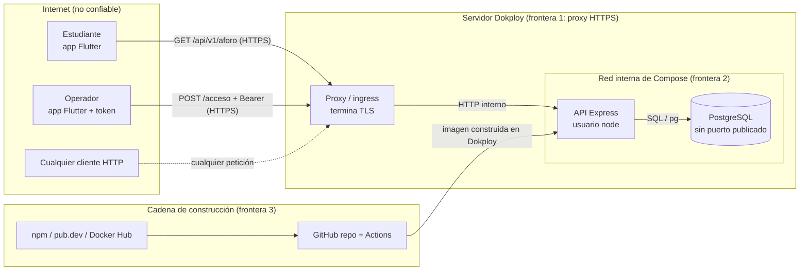

# Evidencia S13 — Modelado de amenazas y plan de mitigación

Este documento aplica STRIDE sobre la arquitectura **que existe hoy** (C4 nivel 2: app Flutter → API Express → PostgreSQL, desplegada con Docker Compose en Dokploy) y no sobre la arquitectura objetivo. Cada amenaza termina en una mitigación con responsable, forma de verificarla y estado.

Convención de estado, igual que en S11 y S12: **IMPLEMENTADO** (existe en el código y tiene prueba), **PENDIENTE** (decidido, con responsable, no hecho), **ACEPTADO** (riesgo asumido de forma explícita, ver arc42 §11.4).

---

## 1. Qué se protege y de quién

### 1.1 Activos

| Activo | Por qué importa |
|---|---|
| **Integridad del aforo** | Es el único dato del sistema. Si es falso, el estudiante decide mal si ir o no, y Bienestar toma decisiones con números inventados. |
| **Disponibilidad de la consulta** | Sin `GET /api/v1/aforo` la app no sirve para nada. |
| **Secretos de despliegue** | `DATABASE_URL` (credenciales de PostgreSQL) y `OPERADOR_TOKEN`. Con cualquiera de los dos se puede alterar el aforo. |
| **Cadena de construcción** | Repositorio, dependencias npm y pub, imágenes base de Docker y GitHub Actions. Lo que entre por ahí corre con los mismos privilegios que nuestro código. |
| **Datos personales (futuros)** | Código estudiantil, historial de accesos y tokens push cuando existan (sección 5). Hoy no se tratan. |

### 1.2 Atacantes plausibles

| Actor | Qué ganaría | Capacidad |
|---|---|---|
| **A1. Estudiante bromista o malintencionado** | Hacer que el gimnasio "se vea lleno" para tenerlo libre, o vacío para generar una multitud. | Lee el README público del repo, ve la URL y el contrato OpenAPI, sabe usar `curl`. |
| **A2. Bot o escáner de internet** | Nada específico: prueba rutas, satura servicios expuestos, busca secretos filtrados. | Automatizado, alto volumen. |
| **A3. Paquete o imagen comprometida** | Ejecutar código en el CI o en el contenedor de producción, robar `DATABASE_URL`. | Entra por `npm ci`, `flutter pub get` o `FROM node:22-alpine`. |
| **A4. Persona con el token de operador** (operador saliente, token copiado de un celular) | Registrar entradas y salidas falsas sin que quede rastro de quién fue. | Token válido. |

El actor más probable es **A1**: el repositorio es público, el README documenta `POST /api/v1/aforo/acceso` con ejemplos y, antes de este cambio, ese endpoint no pedía ninguna credencial.

### 1.3 Diagrama de flujo de datos con fronteras de confianza



Las tres fronteras son los lugares donde STRIDE se aplica: lo que cruza de Internet al proxy, del proxy a la API, y de los registros públicos al código que se ejecuta.

---

## 2. Método de priorización

- **Probabilidad (P):** 1 = requiere acceso privilegiado; 2 = requiere conocimiento o una condición poco común; 3 = cualquiera con la URL puede hacerlo hoy.
- **Impacto (I):** 1 = molestia sin efecto en el dato; 2 = degrada el servicio o expone información menor; 3 = aforo falso, secreto comprometido o servicio caído.
- **Riesgo = P × I.** **Alto** ≥ 6, **Medio** 3–4, **Bajo** ≤ 2. Se atiende en ese orden; dentro del mismo nivel, primero lo más barato.

El riesgo se califica **antes** de la mitigación (riesgo inherente) para que se vea por qué se priorizó así. La columna "Residual" dice qué queda después.

---

## 3. Tabla de amenazas priorizadas (STRIDE)

| ID | STRIDE | Elemento | Amenaza concreta | P | I | Riesgo | Mitigación | Verificación | Responsable | Estado | Residual |
|---|---|---|---|---|---|---|---|---|---|---|---|
| **T1** | S, T | `POST /api/v1/aforo/acceso` | Cualquiera con la URL (A1, A2) registra entradas o salidas falsas. Antes de S13 el endpoint no pedía credencial. | 3 | 3 | **9 Alto** | **M1.** `Authorization: Bearer` con token de operador; comparación en tiempo constante; falla cerrado si el servidor no tiene token. ADR-0007. | `tests/seguridad.test.js` (M1 ×4) y contrato `401` / `503` en `tests/contrato.test.js`. | Sebastián | IMPLEMENTADO | Bajo: depende de que el token no se filtre (T3). |
| **T2** | T, I | Navegador con Flutter web | Una página de terceros usa el navegador del operador para llamar a la API o leer sus respuestas. | 2 | 2 | **4 Medio** | **M2.** CORS con lista blanca (`CORS_ORIGINS`); el token vive en memoria, no en cookie, así que no hay CSRF automático. | `tests/seguridad.test.js` (M2: origen permitido, origen ajeno y preflight). | Sebastián | IMPLEMENTADO | Bajo. |
| **T3** | S, R | Token de operador compartido | El token se filtra (A4) y quien lo tenga opera sin dejar rastro de identidad. No hay forma de saber qué operador registró qué. | 2 | 3 | **6 Alto** | **M3.** (a) token ≥ 32 caracteres generado con `crypto.randomBytes`, solo en el panel de Dokploy; (b) app Flutter no lo persiste; (c) log `auth.operator_rejected` sin el valor; (d) rotación al cambiar de operador; (e) a futuro, usuarios por operador en el contexto Identidad + columna `origen` en el log de ADR-0006. | (a)–(c) en código y pruebas; (d) procedimiento en la sección 7; (e) condición de revisión de ADR-0007. | Sebastián (a–c), Pedro (d), equipo (e) | PARCIAL: a–c IMPLEMENTADO; d PENDIENTE; e ACEPTADO | Medio hasta (e). Riesgo aceptado en arc42 §11.4. |
| **T4** | R | Contador sin historia | Si alguien altera el aforo, no hay forma de reconstruir qué pasó: cada `UPDATE` sobrescribe el valor. | 2 | 2 | **4 Medio** | **M4.** Log de eventos append-only de ADR-0006 con `origen`. | Pruebas planeadas en S12 §7. | Sebastián | PENDIENTE (diseño S12) | — |
| **T5** | D | API y PostgreSQL | Inundación de peticiones (A2) o un cuerpo enorme. El pool de `pg` no tiene timeouts (F3 de S11) y todas las escrituras compiten por una fila (F4). | 2 | 3 | **6 Alto** | **M5a.** Límite de cuerpo JSON de 1 KB → `413`. **M5b.** Autenticación antes del parseo: sin token no se lee el cuerpo ni se toca la base. **M5c.** Timeouts del pool (diseño S11 §3.7). **M5d.** Límite de tasa por IP en el proxy de Dokploy. | M5a–b: contrato `413` y pruebas M1. M5c–d: sin prueba aún. | Sebastián (a–c), Pedro (d) | PARCIAL: a–b IMPLEMENTADO; c–d PENDIENTE | Medio: un `GET` masivo sigue pegándole a PostgreSQL hasta tener M5c y la caché de S12. |
| **T6** | I | Respuestas HTTP | Mensajes de error con detalles internos o cabeceras que revelan el stack (`X-Powered-By: Express`). | 2 | 1 | **2 Bajo** | **M6.** Mensajes genéricos en `503`/`500` (ya existía); `X-Powered-By` desactivado; `nosniff`, `X-Frame-Options`, `Referrer-Policy`, CSP `default-src 'none'`. | Contrato ("detalle interno no expuesto") y `tests/seguridad.test.js` (M5 cabeceras). | Sebastián | IMPLEMENTADO | Bajo. |
| **T7** | I | Secretos | `DATABASE_URL` u `OPERADOR_TOKEN` terminan en el repo, en la imagen o en los logs. | 1 | 3 | **3 Medio** | **M7.** `.env` en `.gitignore` y `.dockerignore`; Dokploy genera `deploy/.env`; el logger no recibe payloads ni cabeceras. Revisión del historial de git sin secretos (sección 4.3). | `git log -p --all` revisado; `.env.example` solo con marcadores. | Sebastián | IMPLEMENTADO | Bajo. |
| **T8** | T, E | Dependencias npm | Una versión maliciosa o vulnerable de un paquete (A3) llega a producción. | 2 | 3 | **6 Alto** | **M8.** `package-lock.json` + `npm ci`; `--ignore-scripts` en CI y Dockerfile (ya existía); `npm audit --audit-level=high` en CI; **nuevo:** `npm audit signatures` en CI y Dependabot semanal; corrección de `qs` (sección 4.1). | CI (`.github/workflows/ci.yml`), `.github/dependabot.yml`. | Sebastián | IMPLEMENTADO | Bajo-medio: Dependabot avisa, pero alguien tiene que revisar cada PR. |
| **T9** | T, E | Imágenes base | `node:22-alpine` y `postgres:16-alpine` son etiquetas móviles: el mismo `FROM` puede traer otra imagen mañana. | 1 | 3 | **3 Medio** | **M9.** Fijar por digest (`node:22-alpine@sha256:…`) y dejar que Dependabot (ecosistema `docker`, ya configurado) proponga la actualización. | Revisión del `Dockerfile` y del Compose. | Pedro | PENDIENTE | — |
| **T10** | T, E | GitHub Actions | Una acción referenciada por etiqueta (`actions/checkout@v4`) cambia de contenido, o el job tiene permisos de escritura que no necesita. | 1 | 3 | **3 Medio** | **M10.** `permissions: contents: read` en el workflow (**hecho**); fijar acciones por SHA (Dependabot `github-actions` ya configurado para actualizarlas). | `ci.yml`. | Pedro | PARCIAL: permisos IMPLEMENTADO; SHA PENDIENTE | Bajo. |
| **T11** | T, E | Dependencias Flutter | `pubspec.yaml` declara 46 dependencias directas, pero el código solo importa 3 en tiempo de ejecución (`http`, `intl`, `shared_preferences`). Cada paquete sobrante es superficie de ataque sin beneficio. | 2 | 2 | **4 Medio** | **M11.** Eliminar las dependencias no usadas, regenerar `pubspec.lock` y dejar que Dependabot (`pub`) vigile el resto. | `grep -rhoE "package:[a-z_]+" lib` debe coincidir con `dependencies:`. | Rodrigo | PENDIENTE | — |
| **T12** | T | PostgreSQL | Acceso directo a la base desde fuera, o la API con más privilegios de los necesarios. | 1 | 3 | **3 Medio** | **M12.** PostgreSQL sin `ports:` en el Compose (solo red interna; ya existía). Pendiente: usuario de aplicación sin permisos DDL, separado del que usa `db-init`. | `deploy/compose.lab.yaml`. | Pedro | PARCIAL | Bajo. |
| **T13** | I, T | Transporte | El token viaja en texto plano si alguien apunta la app a `http://`. | 1 | 3 | **3 Medio** | **M13.** La URL por defecto de la app es `https://`. Pendiente: verificar en Dokploy la redirección HTTP→HTTPS y activar HSTS en el proxy. | `aforo_api.dart`; prueba manual con `curl -I http://…`. | Pedro | PARCIAL | Bajo. |
| **T14** | T | Código generado con IA | Código o dependencias propuestas por un modelo (incluidos nombres de paquetes inventados que alguien registra con malware) entran sin revisión. | 2 | 2 | **4 Medio** | **M14.** Registro en `docs/ia.md`, regla G3 de `arch:check` (ninguna dependencia no declarada), revisión humana y pruebas en CI; no pegar secretos en herramientas de IA. | `npm run arch:check`, `docs/ia.md`. | Equipo | IMPLEMENTADO | Bajo. |
| **T15** | I | `GET /metrics` | Expone los contadores de operación a cualquiera. | 3 | 1 | **3 Medio** | Ninguna por ahora: los números no son personales y también se ven en el aforo. | — | — | ACEPTADO | Bajo. |
| **T16** | T | Repositorio | Archivos binarios no revisables (`entrega-taller-mensajeria/*.rar`) y archivos accidentales (`h -h github.com -s workflow`) en `main`. Un binario no pasa por revisión de código ni por SonarCloud. | 1 | 1 | **1 Bajo** | Eliminarlos de `main` (el contenido del `.rar` ya está en claro en la misma carpeta). | `git ls-files`. | Sebastián | PENDIENTE | — |

### 3.1 Lectura de la tabla

- **Las dos amenazas de mayor riesgo inherente (T1 = 9) y la mayor parte de T5 se cerraron esta semana con código y pruebas.** T1 era el problema real del sistema: el README documentaba cómo alterar el aforo sin credenciales.
- **T3 queda como el riesgo residual más alto.** Un token compartido resuelve "cualquiera de internet", pero no "cuál operador". Eso necesita el contexto Identidad, que no existe; se acepta con condiciones en arc42 §11.4.
- **La cadena de suministro (T8–T11) se ataca con automatización, no con revisiones manuales:** CI que falla y PR de Dependabot que pasan por el mismo CI.

---

## 4. Análisis de dependencias (cadena de suministro)

### 4.1 Backend (npm) — ejecutado el 1 de noviembre de 2026

| Comprobación | Resultado |
|---|---|
| Dependencias directas de producción | `express` 4.22.3, `pg` 8.23.0 |
| Dependencias directas de desarrollo | `ajv`, `dependency-cruiser`, `js-yaml` |
| Total instalado (`npm audit` metadata) | 82 de producción, 47 de desarrollo, 129 en total |
| `npm audit` antes | **1 moderada**: `qs` 6.16.0 (transitiva vía `express` y `body-parser`), aviso GHSA-6pq8-jhm2-2vcw, denegación de servicio en `qs.stringify` con `arrayFormat: 'comma'`. |
| Corrección | `qs` 6.16.0 → **6.16.2** en `package-lock.json` (3 líneas: versión, URL e integridad). Cambio de parche dentro del rango que ya pide `express`. |
| `npm audit` después | **0 vulnerabilidades.** |
| Exposición real antes de corregir | Baja: la API no llama `qs.stringify` y el aviso es moderado, por eso el CI (`--audit-level=high`) no lo detuvo. Se corrigió igual porque costaba tres líneas. |
| Scripts de instalación | Desactivados con `--ignore-scripts` en CI y Dockerfile: un paquete comprometido no ejecuta código al instalarse. |
| Firmas de registro | **Nuevo paso de CI:** `npm audit signatures`. No se pudo ejecutar en el entorno de análisis (usa un espejo del registro); se ejecuta en GitHub Actions contra `registry.npmjs.org`. |
| Imagen de producción | `node:22-alpine`, `npm ci --omit=dev`, proceso como usuario `node`, sin `tests/` ni `docs/` (`.dockerignore`). Etiqueta móvil: ver T9. |

### 4.2 App Flutter (pub)

| Comprobación | Resultado |
|---|---|
| Dependencias declaradas en `pubspec.yaml` | 46 entradas en `dependencies` (incluye implementaciones de plataforma listadas una por una, típico de un proyecto exportado de FlutterFlow). |
| Paquetes importados de verdad en `lib/` | `http`, `intl`, `shared_preferences` (+ `flutter_test` en pruebas). |
| Consecuencia | Unas 40 dependencias no aportan nada y sí agregan superficie (T11). |
| Auditoría de vulnerabilidades | No se ejecutó `flutter pub` en el entorno de análisis (sin SDK de Flutter). Dependabot con ecosistema `pub` queda configurado para reportar avisos de GitHub sobre `pubspec.lock`. |

### 4.3 Secretos

- `git log -p --all` revisado buscando `password=`, `secret=`, `token=`: solo aparecen referencias a variables (`${POSTGRES_PASSWORD:?…}`) y marcadores `REEMPLAZAR_…`. No hay credenciales reales en el historial.
- `.env`, `.env.*` y `deploy/.env` están ignorados por git y por Docker.

---

## 5. Privacidad y minimización de datos

### 5.1 Qué datos personales trata el sistema hoy

| Dato | ¿Se trata hoy? | Dónde | Finalidad | Observación |
|---|---|---|---|---|
| Número de personas dentro | Sí | `aforo_estado` | Mostrar ocupación | **No es dato personal:** es un agregado. |
| Tipo de transición (`ENTRADA`/`SALIDA`) | Sí, en tránsito | Petición HTTP | Actualizar el contador | No se guarda ni identifica a nadie. |
| Campos extra en el cuerpo (p. ej. `estudianteId`) | **No** | — | — | La API los ignora: el router solo lee `tipoAcceso` y el logger no registra payloads. Una prueba de integración envía `estudianteId` y nada lo persiste. |
| Dirección IP del cliente | No en la aplicación; **probablemente sí en el proxy** de Dokploy | Logs del ingress | Operación y seguridad | **Por verificar** la retención de esos logs en Dokploy (responsable: Pedro). La IP puede ser dato personal. |
| Preferencias de alerta (días, horario, umbral) | Sí, **solo en el dispositivo** | `SharedPreferences` | Configurar avisos | No salen del teléfono. No se sincronizan con el backend. |
| Token de operador | Sí | Memoria de la app; variable del servidor | Autenticar escrituras | Credencial, no dato personal. No se persiste en el dispositivo. |

**Conclusión: hoy el backend no trata datos personales de estudiantes.** Es una consecuencia de diseño que hay que proteger, no un accidente: la forma más barata de cumplir con datos personales es no recolectarlos.

### 5.2 Datos que aparecerían con las funciones futuras y regla de minimización

| Función futura | Dato que necesitaría | Mínimo necesario | Regla |
|---|---|---|---|
| QR de acceso por estudiante (Identidad) | Código estudiantil | Un identificador **seudónimo** derivado del código (HMAC con clave del servidor) en el log de eventos; el código en claro solo en el contexto Identidad. | Nunca cédula, nombre ni foto en el contexto Aforo. |
| Historial de accesos (ADR-0006) | Quién entró y cuándo | Eventos con seudónimo; reportes a Bienestar **solo agregados** (por hora, por día). | Definir plazo de retención y desvinculación **antes** de agregar `estudiante_id` (regla 4 de ADR-0006). |
| Notificaciones push | Token FCM del dispositivo | Solo si el estudiante activa alertas (*opt-in*); borrarlo al desactivarlas. | Sin token push para quien no pidió alertas. |
| Preferencias sincronizadas | Días, horario, umbral | Las mismas que hoy, asociadas al seudónimo. | Mantenerlas locales mientras no haya evaluación en el servidor. |

### 5.3 Con qué base se tratarían

En Colombia el marco general es la Ley Estatutaria 1581 de 2012 y su Decreto reglamentario 1377 de 2013. La ley define la autorización como consentimiento previo, expreso e informado del titular, y sus principios incluyen finalidad, libertad, acceso y circulación restringida, seguridad y confidencialidad.

Para este proyecto eso se traduce en:

- **Responsable del tratamiento:** la UTB, no el equipo. Cualquier dato de estudiantes debe tratarse bajo la política de tratamiento de datos de la universidad.
- **Base:** autorización del estudiante al activar el QR o las alertas, con finalidad explícita ("contar accesos al gimnasio y avisarte del aforo"), no un uso genérico.
- **Hoy no se necesita autorización** porque no se recolecta ningún dato personal en el backend.

Este documento **no afirma cumplimiento legal**; describe qué datos haría falta tratar y cómo minimizarlos. La validación corresponde a la universidad.

---

## 6. Riesgos específicos de IA generativa

El sistema **no tiene ningún componente generativo en ejecución**: no llama a un modelo, no recibe prompts del usuario ni produce texto con IA. Por eso no aplican inyección de prompts, fuga de datos por el modelo ni costos por token.

Sí aplica a **cómo se construyó el sistema** (T14):

| Riesgo | Control en este repositorio |
|---|---|
| Paquete inventado por el modelo (*slopsquatting*) | Regla G3 de `arch:check`: ninguna importación sin declarar en `package.json`; `npm audit signatures` verifica que lo instalado venga firmado por el registro. |
| Código inseguro aceptado sin entenderlo | Cada uso queda en `docs/ia.md` con lo aceptado, corregido y rechazado; CI con pruebas y contrato; sustentación individual. |
| Secretos pegados en una conversación con IA | Regla del equipo: nunca pegar `.env`, `DATABASE_URL` ni el token; se comparten solo los `.env.example`. |

**Condición de revisión:** si se agrega una función con IA (por ejemplo, un asistente que recomiende horarios), este análisis se repite con las amenazas propias: inyección de prompts, salida no confiable usada como dato, datos personales enviados al proveedor y costo por abuso.

---

## 7. Plan priorizado con responsables

| Orden | Acción | Amenaza | Responsable | Cómo se verifica que está hecho | Estado |
|---|---|---|---|---|---|
| 1 | Token de operador en `POST /acceso`, falla cerrado | T1, T5 | Sebastián | Pruebas M1 y contrato `401`/`503` en CI | IMPLEMENTADO |
| 2 | **Configurar `OPERADOR_TOKEN` en Dokploy** (sin él, el registro responde `503`) | T1 | Pedro | `curl -X POST …/acceso` sin token → `401`; con token → `201` | PENDIENTE — **bloquea la demo de registro** |
| 3 | CORS con lista blanca, cabeceras, límite de cuerpo | T2, T5, T6 | Sebastián | Pruebas M2, M5 y contrato `413` | IMPLEMENTADO |
| 4 | `npm audit signatures`, permisos mínimos del workflow, Dependabot, `qs` 6.16.2 | T8, T10 | Sebastián | CI en verde; PR de Dependabot apareciendo | IMPLEMENTADO |
| 5 | Timeouts del pool de PostgreSQL (diseño S11 §3.7) | T5 | Sebastián | Prueba con pool que no responde → `503` en < 5 s | PENDIENTE |
| 6 | Límite de tasa y HSTS/redirección HTTPS en el proxy de Dokploy | T5, T13 | Pedro | `curl -I http://…` → 301/308; ráfaga de 100 peticiones → `429` | PENDIENTE |
| 7 | Fijar imágenes base y acciones por digest/SHA | T9, T10 | Pedro | `grep "@sha256" Dockerfile` | PENDIENTE |
| 8 | Podar `pubspec.yaml` a lo que se usa | T11 | Rodrigo | `flutter pub get` y `flutter test` en verde con 3 dependencias de ejecución | PENDIENTE |
| 9 | Procedimiento de rotación del token (generar, cambiar en Dokploy, redeploy, avisar a operadores) | T3 | Pedro | Documentado en el README y ejecutado una vez | PENDIENTE |
| 10 | Eliminar `.rar` y archivo accidental de `main` | T16 | Sebastián | `git ls-files` | PENDIENTE |
| 11 | Usuarios por operador (Identidad) y `origen` en el log | T3, T4 | Equipo | Condición de revisión de ADR-0007 | ACEPTADO / FUTURO |

**Generar el token** (una sola vez, en una terminal propia, nunca en el chat del grupo):

```bash
node -e "console.log(require('crypto').randomBytes(32).toString('hex'))"
```

---

## 8. Trazabilidad

- Decisión estructural: [ADR-0007](adr/0007-autenticacion-operador-y-cors.md).
- Arquitectura de seguridad: arc42 §8.8. Amenazas aceptadas: arc42 §11.4.
- Código: `src/shared/http/seguridad.js`, `src/server.js`; cliente `docs/Flutter/lib/core/api/aforo_api.dart`.
- Pruebas: `tests/seguridad.test.js`, `tests/contrato.test.js`, `docs/Flutter/test/core/api/aforo_api_test.dart`.
- Contrato: `docs/openapi.yaml` 2.0.0 (`securitySchemes.tokenOperador`).
