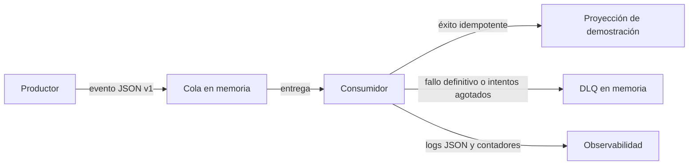

# Taller: mensajería asíncrona

## Objetivo y alcance

Este taller demuestra el recorrido productor → cola → consumidor → resultado, con contrato versionado, deduplicación, reintentos, DLQ y observabilidad. Es un **prototipo educativo aislado**; no cambia el backend ni la respuesta de `POST /api/v1/aforo/acceso`.

La API real procesa las transiciones del contador de forma síncrona: espera la regla de dominio y la escritura PostgreSQL antes de responder. No hay un procesamiento posterior que justifique hoy introducir mensajería en ese flujo. El repositorio no implementa un broker, una cola durable ni un consumidor. En particular, FCM y WebSocket son objetivos futuros, no componentes disponibles. El prototipo usa el evento de acceso como caso didáctico, pero solo conserva `tipoAcceso`, sin identificadores ni datos personales, y actualiza una proyección de demostración en memoria.

## Arquitectura



- **Productor:** `createProducer` crea un evento con UUID y lo publica en `InMemoryMessageQueue`.
- **Contrato:** `eventId`, `eventType`, `occurredAt`, `schemaVersion` y `data.tipoAcceso`; los detalles están en [contrato-mensaje.md](./contrato-mensaje.md).
- **Consumidor:** valida el contrato, procesa el mensaje y emite logs estructurados.
- **Idempotencia:** guarda los IDs procesados en un conjunto en memoria y evita también que dos entregas concurrentes del mismo ID invoquen dos veces el manejador.
- **Reintentos:** tres intentos totales para errores expresamente clasificados como recuperables; espera 100 ms antes del segundo y 200 ms antes del tercero. Los errores no recuperables van directamente a la DLQ.
- **DLQ:** lista en memoria con mensaje, número de intentos, fecha y causa del fallo.
- **Observabilidad:** logs JSON por intento y contadores de intentos, procesados, duplicados, reintentos, fallos definitivos y mensajes en DLQ.

## Tecnologías y prerrequisitos

- Node.js 18 o superior, compatible con el proyecto.
- JavaScript CommonJS y módulos nativos de Node.js (`node:crypto`, `node:test`); el prototipo no agrega dependencias ni requiere PostgreSQL, Docker o servicios externos.
- En una copia limpia, `npm ci` prepara las dependencias del repositorio. Las pruebas y el demo de este taller no necesitan una base de datos.

## Ejecutar y probar

Desde la raíz del repositorio:

```bash
npm ci
npm run demo:mensajeria
npm run test:mensajeria
```

El demo publica y consume una entrada, escribe registros JSON por stdout y luego imprime el evento, el resultado, la proyección de ejemplo, las métricas y el tamaño de la DLQ. El `eventId` y la fecha se generan en cada ejecución. Las pruebas usan un `sleep` inyectado para comprobar los intervalos sin esperar realmente.

Para ejecutar además las verificaciones habituales de la aplicación:

```bash
npm run test:base
npm run test:contrato
npm run test:postgres
npm run arch:check
```

El comando `npm test` también incluye `test:mensajeria`; GitHub Actions ejecuta este último como paso explícito.

La prueba PostgreSQL puede omitirse si `DATABASE_URL` no está configurada; no se necesita para el taller. Resultados reales de esta entrega: [evidencia-pruebas.md](./evidencia-pruebas.md).

## Garantías y límites

La cola, la DLQ, las métricas y los IDs procesados solo viven en memoria. El experimento **no ofrece entrega durable ni garantiza at-least-once frente a caídas del proceso**, ni exactamente una vez. Los intentos repetidos en el consumidor simulan la política de reintentos, pero no sustituyen un broker con confirmaciones y persistencia. Consulte [límites-experimento.md](./limites-experimento.md) y la decisión en [ADR-001](./ADR-001-mensajeria-asincrona.md).
