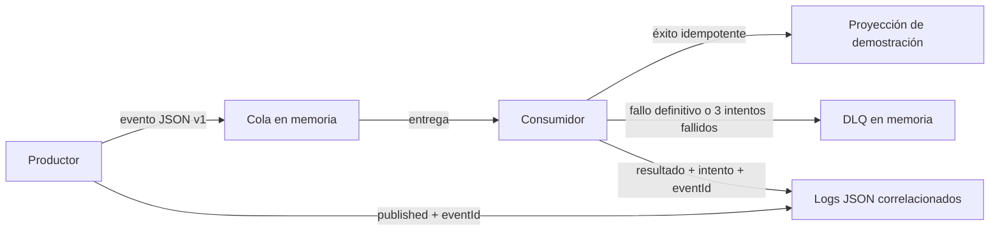

# Entrega académica: Taller de mensajería asíncrona

## Objetivo

Presentar una demostración pequeña y reproducible del ciclo productor → cola → consumidor → resultado: contrato versionado, deduplicación, reintentos con backoff, DLQ y trazabilidad. El prototipo es experimental y no modifica el flujo operativo del backend Gimnasio UTB.

## Problema y decisión de alcance

La mensajería asíncrona permite separar la aceptación de una operación de trabajos posteriores, reducir el acoplamiento temporal y aislar fallos de consumidores. En este proyecto, `POST /api/v1/aforo/acceso` sí existe, pero responde después de aplicar la regla de dominio y persistir el contador en PostgreSQL. No se verificó ningún trabajo posterior real que justifique modificar ese contrato, y no hay broker, cola durable ni consumidor productivo implementados.

Por eso el taller queda aislado: simula un evento `aforo.acceso.registrado` con solo `tipoAcceso` y actualiza una proyección temporal en memoria. No transporta datos personales ni cambia el contador real.

## Arquitectura y funcionamiento



- **Contrato:** `eventId`, `eventType`, `occurredAt`, `schemaVersion` y `data.tipoAcceso`; los campos, validación y compatibilidad se documentan en [contrato-mensaje.md](01-documentacion/contrato-mensaje.md).
- **Idempotencia:** el consumidor recuerda IDs procesados durante la vida del proceso y evita repetir el efecto en entregas secuenciales o concurrentes.
- **Reintentos:** hasta tres intentos totales. Solo `RecoverableProcessingError` se reintenta: espera 100 ms tras el primer error y 200 ms tras el segundo. Los errores definitivos van directamente a DLQ.
- **DLQ:** fallos definitivos y agotamiento de reintentos se registran en una lista local con el mensaje y su causa.
- **Trazabilidad:** productor y consumidor registran el mismo `eventId` como `correlationId`, además de tipo, resultado e intento cuando corresponde.

No se ofrece exactamente una vez, entrega durable ni at-least-once. La cola, la DLQ y el registro de idempotencia son estructuras volátiles; un reinicio puede perder mensajes y permitir repetir efectos.

## Contenido de esta entrega

| Ruta | Contenido |
|---|---|
| `README.md` | Esta guía: alcance, ejecución, pruebas y resultados. |
| `package.json` | Scripts npm mínimos para ejecutar demo y pruebas; no declara dependencias externas. |
| `01-documentacion/README-taller.md` | Objetivos y arquitectura del taller original. |
| `01-documentacion/contrato-mensaje.md` | Campos, ejemplos, validación y versionado del evento. |
| `01-documentacion/ADR-001-mensajeria-asincrona.md` | Decisión entre procesamiento síncrono, integración asíncrona y prototipo aislado. |
| `01-documentacion/evidencia-pruebas.md` | Comandos ejecutados y resultados comprobados. |
| `01-documentacion/limites-experimento.md` | Garantías ausentes y trabajo requerido para producción. |
| `02-codigo/index.js` | Contrato, productor, cola, consumidor, reintentos e idempotencia. |
| `02-codigo/demo.js` | Demostración de publicación y procesamiento. |
| `03-pruebas/messaging.test.js` | Pruebas automatizadas del prototipo. |
| `04-entrega/datos-entrega.md` | Plantilla de datos académicos por completar. |

## Requisitos

- Node.js 18 o posterior y npm, para ejecutar los comandos de esta guía.
- No requiere PostgreSQL, Docker, servicios externos, broker ni dependencias npm adicionales.

## Ejecutar desde esta carpeta

Abre PowerShell en `entrega-taller-mensajeria`:

```powershell
npm.cmd run demo:mensajeria
npm.cmd test
```

También se puede ejecutar directamente con Node:

```powershell
node 02-codigo\demo.js
node --test 03-pruebas\messaging.test.js
```

La carpeta es autónoma para el demo y sus pruebas. No requiere ejecutar comandos desde la raíz del repositorio, instalar `node_modules` ni usar `npm ci`.

## Resultados comprobados

Verifiqué esta copia ejecutando `npm.cmd run demo:mensajeria` y `npm.cmd test` **desde la carpeta de entrega**: el demo publicó y procesó un evento en el primer intento, y las **9 pruebas pasaron** sin fallos ni omisiones. También ejecuté `npm.cmd test` en la raíz del proyecto: **32 pruebas pasaron y 1 prueba PostgreSQL se omitió** porque no estaba configurada `DATABASE_URL`. El detalle y el alcance de ambas ejecuciones constan en [evidencia-pruebas.md](01-documentacion/evidencia-pruebas.md).

## Repositorio y commit

- Repositorio: [ISCOUTB/AS_202620_GimnasioUTB](https://github.com/ISCOUTB/AS_202620_GimnasioUTB)
- Commit del proyecto verificado en `origin/main` al preparar esta carpeta: [96898ae](https://github.com/ISCOUTB/AS_202620_GimnasioUTB/commit/96898ae)
- Esta carpeta de entrega no tiene un commit propio ni se ha publicado como artefacto separado.

## Límites

Esto es un experimento educativo local, no un sistema desplegado. No hay persistencia, ACK, reentrega de broker, retención de DLQ, alertas ni coordinación de deduplicación entre procesos. Consulte [límites-experimento.md](01-documentacion/limites-experimento.md) y el [ADR](01-documentacion/ADR-001-mensajeria-asincrona.md).
